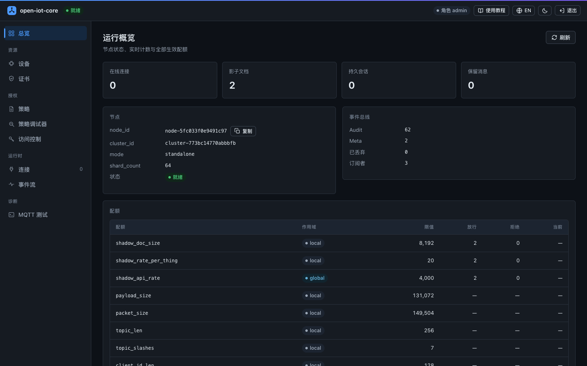
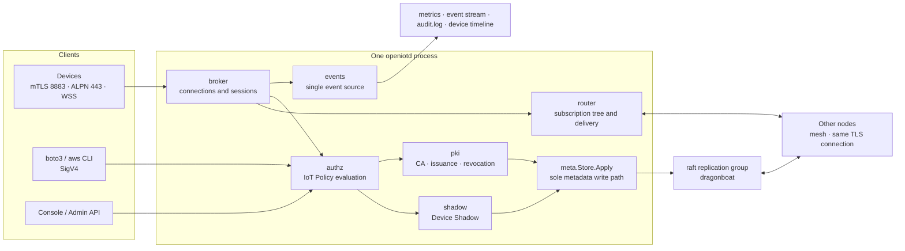

<div align="center">

# open-iot-core

**Run an AWS IoT Core–compatible device data and management plane on your own infrastructure.**

MQTT broker, device registry, certificate PKI, Device Shadow, IoT Policy, an
AWS-compatible API and the admin console ship in one static binary. No Redis,
PostgreSQL or callback service is required.

[](LICENSE) [](go.mod) [](#-capability-matrix) [](#-architecture) [](https://github.com/itmisx/open-iot-core/pkgs/container/open-iot-core) [](https://github.com/itmisx/open-iot-core/actions/workflows/ci.yml)

[简体中文](README.md) · **English**

<sub>Apache-2.0 · the same artifact for standalone and clustered deployments · linux/amd64, linux/arm64, darwin/arm64</sub>

</div>



<p align="center"><sub>Web console overview</sub></p>

## Why open-iot-core

| Scenario | What you get |
| --- | --- |
| **Move away from AWS IoT Core** | Keep the AWS IoT Device SDK on devices; point `boto3` and the `aws` CLI at a different endpoint |
| **Air-gapped, on-premises or data-residency deployments** | Run the broker, identity, authorization, shadows and management plane locally |
| **Avoid assembling an IoT platform from services** | MQTT, PKI, registry, policies, shadows, audit, metrics and a console in one process |
| **Use clustering without a commercial license** | Apache-2.0; metadata, shadows, persistent sessions and offline queues replicate across nodes |

### Evidence, not just a feature list

| Surface | Repository acceptance criterion |
| --- | --- |
| **Real client compatibility** | AWS IoT Device SDK, `boto3` and the `aws` CLI run against a temporary node |
| **Cluster failover** | Three real processes; kill the leader, elect another and continue writing; recover persistent sessions and offline queues on another node |
| **Protocol and concurrency correctness** | Race detector, deterministic simulation and short fuzzing; at least 95% coverage in MQTT, authorization and shadow packages |
| **Console usability** | 37 flows execute in real Chromium; browser errors and unhandled promise rejections fail the run |
| **Merge gate** | Formatting, static analysis, architecture contracts, race tests, coverage, cross-compilation and fuzzing run under `make gate` |
| **Performance data** | Throughput, latency, connection rate and per-connection memory come from one `make bench-e2e` run; script, environment record and raw data are all committed |

> [!NOTE]
> The project is currently **pre-1.0**. It connects real devices, but has no public
> production deployment yet. This is not a “production ready” claim; read the
> [known limitations](#-known-limitations) before deploying.

## Highlights

| | |
| --- | --- |
| 📦 **Single binary** | No CGO; the console is compiled into the same file via `go:embed`. No Redis, PostgreSQL or rule-engine sidecar |
| 🔌 **Reuse existing SDKs** | `boto3`, the `aws` CLI and the AWS IoT Device SDK work by pointing their endpoint at this node — no client code changes |
| 🔐 **Secure by default** | Mandatory TLS, mandatory authentication, fail-closed for new connections while the view is stale. Insecure options require three independent acknowledgement gates |
| 📖 **Specification first** | QoS 2, `sensor/#` matching `sensor`, retained delivery to wildcard subscriptions, the DUP flag — where AWS does not support these or deviates from the specification, this project follows OASIS |
| 🧩 **Three direct dependencies** | `bbolt`, `yaml/v3`, `dragonboat`. The console has only `react` and `react-dom` |
| 🪪 **Apache-2.0** | Not BSL / SSPL / ELv2; clustering is not charged separately |
| 🔍 **Explainable authorization** | A policy dry-run returns the decision, the index of the matching statement, the resolved value of every policy variable, and a remediation suggestion — verifiable without connecting a real device |

## Quick start

Start a standalone node with Docker Compose. No separate `init` command is needed:

```bash
git clone https://github.com/itmisx/open-iot-core.git
cd open-iot-core/deploy/standalone/compose
docker compose up -d

# Print the admin token required by the console
docker compose exec openiotd openiotd admin token
```

The console is at **<http://127.0.0.1:9090/>** and the MQTT mTLS endpoint is
`127.0.0.1:8883`. Data is kept in a Docker volume.

Running from source requires Go but does not require Node:

```bash
go build -o openiotd ./cmd/openiotd
./openiotd init --data-dir ./data
./openiotd cert issue --data-dir ./data --thing dev-001 --policy device-scoped
./openiotd serve --data-dir ./data
```

See [Deployment](#-deployment) for standalone, clustered, Docker and Kubernetes paths.

<details>
<summary><b>🧯 Common causes of a failed first connection</b> — check here first when you get <code>NotAuthorized</code></summary>

<br>

The `device-scoped` policy written by `init` allows exactly one prefix, scoped to the device name:

```
Connect     clientId must equal the device name
Publish     $aws/things/<device-name>/*
Subscribe   $aws/things/<device-name>/*
```

Two usages are therefore rejected — **this matches AWS behaviour and is not a fault**:

- a random `clientId` (the default in most GUI clients);
- subscribing to a flat topic such as `sensors/temp` — a flat topic cannot be scoped per device, any device could read and write the same topic, and policy variables would lose their meaning.

The real cause is recorded in the server log's "connection denied" / "authorization denied"
lines (with action, resource, decision, the matching statement index and the resolved value
of every policy variable). It can also be verified through the console's **policy debugger**,
without connecting a real device.

</details>

<details>
<summary><b>🔧 Pointing <code>boto3</code> and the <code>aws</code> CLI at this node</b></summary>

<br>

`endpoint_url` **must include the `/api/aws` prefix**. Without it the request lands on the
console index page and returns HTML; the error reads `invalid character '<'`, which does not
indicate the real cause.

The region must be in the node's allow-list; credentials are access keys issued from the
console's "Access control" page. The full procedure is in the **tutorial** inside the console
(global actions, right of the title bar); its source is under `docs/tutorial/`.

</details>

## 📐 Architecture



Several constraints hold throughout: the **sole path for metadata writes is `meta.Store.Apply`**
(cold-layer records and hot-view changes commit in the same replicated log entry);
instrumentation is **concentrated in the event bus alone**, where metrics accumulate *before*
the sampling gate rather than being derived from the event stream; and single-node writes also
go through a one-replica raft group, so standalone and clustered deployments share one code
path. The derivation is in `docs/prd/02-architecture.md`.

## 📦 Capability matrix

> A vague compatibility claim damages credibility more than a missing feature. The table below
> lists **only what is implemented, covered by tests and green in the merge gate**.

| Domain | Contents |
| --- | --- |
| 🔡 **Protocol** | MQTT 3.1.1 and 5.0, full feature set; QoS 0/1/2; retained; will messages (including Will Delay Interval); session expiry; all MQTT 5 properties; shared subscriptions `$share/` |
| 🔌 **Endpoints** | 8883 mTLS (enabled by default); 443 ALPN `x-amzn-mqtt-ca`; 443 WSS `/mqtt` + SigV4 (the latter two are disabled by default and cannot bind the same address) |
| 🔐 **Authn / authz** | X.509 client certificates; IoT Policy with all policy variables; SigV4 (control plane `iot`, data plane `iotdata`, WebSocket `iotdevicegateway`) |
| 🪪 **PKI** | Built-in CA issuance, CSR issuance, registering your own CA, certificate state machine, disconnecting live connections on revocation |
| 👥 **Platform** | Device Shadow (classic and named, with per-leaf metadata timestamps and 409 version conflicts) |
| 📇 **Registry** | Thing CRUD; certificate-to-device association; search (disabled by default) |
| 🤝 **Compatibility surface** | Control-plane and data-plane actions under `/api/aws`; usable by pointing the `aws` CLI and `boto3` at this node |
| 🛠️ **Admin plane** | `/api/admin/v1`: listing and kicking connections, SSE event stream, policy dry-run, device timeline, shadow read/write, access-key issuance, cluster membership changes |
| 🖥️ **Console** | Overview, devices, certificates, connections, policies, event stream, shadow, MQTT test client and capture, access control, tutorial; Chinese and English; light and dark themes |
| 📊 **Observability** | Prometheus `/metrics` (self-implemented text format); OTLP/HTTP JSON tracing (disabled by default); `audit.log`; `events.jsonl` device timeline |
| 🌐 **Clustering** | Metadata replicated by quorum through dragonboat; cross-node message mesh; cross-node shadow consistency; **persistent sessions and offline queues replicated through session partition groups**; retained messages eventually consistent over the mesh broadcast; admin fan-out; membership changes without restart; cross-node shared subscription groups |
| 🏗️ **Build** | No CGO; cross-compiles for linux/amd64, linux/arm64, darwin/arm64; the console is embedded in the same binary via `go:embed` |

<details>
<summary><b>⚖️ Deliberate differences from AWS</b> — where porting deviations concentrate, listed individually</summary>

<br>

| Item | AWS behaviour | This project |
| --- | --- | --- |
| QoS 2 | Unsupported; no PUBACK/SUBACK when QoS 2 is requested | Full PUBREC/PUBREL/PUBCOMP |
| Does `sensor/#` match `sensor` | No (contrary to the MQTT requirement that `#` match the parent level) | Matches, per the OASIS specification |
| Retained delivery to wildcard subscriptions | Unsupported; the topic must match exactly | Delivered, per the specification |
| DUP flag | Unsupported; redelivery may change the packet ID and does not set DUP | Sets DUP and preserves the packet ID, per the specification |
| MQTT 5 server redirect `0x9C`/`0x9D` | Unsupported | Supported. This is the only graceful mechanism for cluster rebalancing and rolling upgrades |
| Disconnecting live connections on revocation | Immediate disconnection not guaranteed | Disconnected, **bounded by `max_view_staleness`** |
| Message ordering | Message and ACK ordering not guaranteed | Ordered for one publisher to one topic within a node; batch-ordered across nodes |
| Policy dry-run and explanation | None; only after-the-fact log inspection | Returns the decision, the matching statement index, the resolved value of every policy variable, and a remediation suggestion |
| `DescribeEndpoint` | Returns an ATS domain | Returns this node's configured endpoint; `endpointType` is accepted but semantically local |
| Default quotas | The vendor's commercial tiers | Defaults aligned with AWS so behaviour stays predictable |
| Certificate-to-device association | Many-to-many | **One-to-one**; `AttachThingPrincipal` overwrites the previous binding. The authorization path uses it to resolve `${iot:Connection.Thing.ThingName}`, and a policy variable can only hold one value |

</details>

<details>
<summary><b>🚫 Explicitly out of scope</b> — not planned for any release</summary>

<br>

| Excluded | Alternative |
| --- | --- |
| Edge runtimes such as Greengrass | The single binary itself can be deployed as an edge node |
| IoT Analytics / Events / SiteWise / TwinMaker / FleetWise | Separate products; analytics belongs to your own systems |
| IoT Wireless (LoRaWAN / Sidewalk) | None |
| Device Defender ML anomaly detection | Metrics sinks are covered under observability; detection belongs to your own systems |
| Secure Tunneling | `$aws/things/<device-name>/tunnels/notify` is routed as an ordinary topic — no error, and no tunnel semantics |
| Device Location | None |
| Device Advisor / Fleet Hub | Fleet Hub's capabilities are covered by this project's console |
| SiteWise asset-model topics | None |
| Cognito, full IAM, STS | Only SigV4 verification is compatible; the identity model is a local IAM-lite |
| AWS ecosystem rule actions (lambda, dynamodb, kinesis, firehose, sns, sqs, step-functions, timestream, opensearch, cloudwatch, iot-analytics, iot-events, iot-sitewise, salesforce, location) | These actions are not provided |
| Commands (`$aws/commands/...`) | Not implemented |
| CloudTrail, Resource Groups, tag-based billing APIs | Local structured audit log |
| Device protocol gateways other than MQTT (CoAP, LwM2M, MQTT-SN, STOMP) | Not provided. AWS IoT Core itself supports only MQTT and HTTPS |
| MQTT over QUIC | A non-standard extension. Available for inter-node transport, not exposed to devices |
| Bridging to other MQTT brokers | Not offered as a core feature |
| Per-node connection density comparable to EMQX | Targeting 100k–500k connections per node; larger scale relies on horizontal scaling and offloading TLS termination |

</details>

## 📊 Benchmarks

Produced by a single command on one **Apple M3 Pro (11 cores / 36 GiB / macOS 26.3 /
go1.24.4)**; the script, the per-run raw data and the environment record are all in the
repository (re-measured 2026-11-28). The message-plane rows, non-persistent connects
and memory per connection come from one command:

```bash
RESULTS=docs/baseline/throughput make bench-e2e
```

**The persistent-connect and shadow rows go through consensus and need enough
concurrency to be measured at all**, so they come from two attribution scripts driven
along a concurrency ladder (`tests/bench/connect-stage-ab.sh`,
`tests/bench/shadow-attribution.sh`; three runs each, median, a fresh cluster per
invocation). The top rungs of the zero-loss ceilings also need rungs beyond the default
ladder — every rung names its command and raw data on the results page.

| Scenario | Single node (whole machine) | Three-node cluster (one machine, **total**) |
| --- | --- | --- |
| **One-to-one QoS 0, zero-loss ceiling** | **225,005 msg/s**, p50 1.30 ms, p99 6.84 ms | same node **150,004** (lower bound), p50 0.14 ms, p99 1.30 ms<br>cross-node **130,002** (lower bound), p50 0.80 ms, p99 2.46 ms |
| **One-to-one QoS 1** (16 in flight) | 100k offered → **99,997 msg/s**, zero loss, p50 0.38 ms, p99 15.68 ms | cross-node, 40k offered → **40,000**, zero loss, p50 0.51 ms |
| **Fan-out** (1 → 1000 subscribers × 100 msg/s) | **100,007 msg/s**, p50 1.92 ms, p99 6.84 ms | cross-node **100,000**, p50 2.46 ms, p99 7.18 ms |
| **Connects, non-persistent session** (concurrency 256) | **24,911 conn/s**, 12,000 held, p50 7.0 ms | **23,185 conn/s**, 6,000 held, p50 10.4 ms |
| **Connects, persistent session** | same as above (standalone skips consensus) | **10,461 conn/s** (concurrency 2048, 6,000 held, 4 shards), p50 153–159 ms, p99 255–309 ms |
| **Memory per connection** | **2,315 bytes** (heap growth ÷ connections, at 12,000 held) | — |
| **Shadow updates** (through the replicated log) | **13,392 updates/s** (concurrency 800), p50 55.8 ms, p99 100.2 ms | **16,652 updates/s** (concurrency 3200, 4 shards), p50 179.9 ms, p99 265.7 ms |

**Four preconditions**: the load generator and the server share one machine; traffic goes
to the plaintext endpoint (no TLS handshake); authentication is `insecure-none` while
**authorization is still evaluated per operation**; throughput-related quotas are lifted.
Drop any one of them and these numbers get read as what a default configuration can do.

Reading the table:

- **A zero-loss ceiling is measured with a rate ladder** — pressure is raised rung by rung
  until delivery stops keeping up, so it is a ceiling rather than "whatever we offered".
  Both cluster figures are **lower bounds**: every higher rung had subscribers
  disconnected (the broker drops slow subscribers by design when the outbound queue
  fills), and a rung with errors measures how fast subscribers die, not throughput, so it
  is not published.
- **The cluster column is a three-node total**; don't divide it by the single-node column,
  and don't subtract 150k from 225k to get "the cost of clustering": same-node traffic
  takes the same path as single-node (replication is not on the message hot path), and it
  stopped at 150k only because that is as far as this run pushed it. This row is capped by
  **the machine**, not by the node.
- **The connect rows are medians of 3 runs**: single-node range 24,013–35,913, cluster
  non-persistent 21,951–23,202, cluster persistent 10,380–10,619. The first two have a wide
  run-to-run spread, so a single run is not comparable — this round's single-node median is
  below the previous round's 33,321 while the two ranges overlap heavily, so it is not a
  change.
- **These numbers are extremely sensitive to whether the machine is idle.** With the same
  code at `loadAvg1m` 4.04, even the 100k base rung lost 9% and connects fell to 22,116/s;
  this round was measured at 1.65. When two rounds disagree, the first field to check is
  `loadAvg1m` in `env.json`, not the code.
- **The two rows that go through consensus need enough concurrency to be measured at all.**
  Both persistent connects and shadow updates rise with concurrency: persistent connects
  reach only ~1,156/s at concurrency 256, 1,922 at 512, and above 10,000/s at 2048 — **a
  figure taken at low concurrency is capped by the load generator, not by the server**. The
  concurrency used is stated in parentheses for both rows.
- **The shadow row is higher on three nodes than on one**, so don't read it as "a
  cluster is always slower". It also needs enough concurrency: a single node tops out
  at concurrency 800 (at 1600 throughput is flat while p50 doubles), and three nodes
  with 4 shards top out at concurrency 3200 (6400 is lower). Cluster deployments must
  enable `shadow_shards` — the compose and k8s manifests under `deploy/cluster` already
  set 4. Without it, shadow writes go through the single metadata log, whose high point
  on this machine is 337 updates/s (measured 2026-11-23; that rung was not re-measured
  this round). Control-plane writes (shadow, thing creation,
  certificate issuance) go through the replicated log; the device data plane does not.

Every ladder rung, the raw JSONL and the measurement protocol are in
[`docs/baseline/throughput.md`](docs/baseline/throughput.md).

## 🚨 Known limitations

> [!WARNING]
> The following are not planned work, but **existing constraints a deployment faces today**.

**Data and consistency**

- **While a node is down, messages for the offline devices that were last attached to it are no longer queued.** Sessions and offline queues themselves are replicated across nodes (2026-11-20), so a node failure does not lose them; but enqueueing requires the subscription to be in the local routing table, and that only holds on the node the device last attached to. Normal behaviour resumes once that node is back, or once the device reconnects elsewhere (MQTT-128, CLU-111).
- **Cross-node retained-message sync is eventually consistent.** It goes over the mesh broadcast rather than through consensus (2026-11-19); the window is one broadcast, so a subscriber on node B that subscribes before the broadcast arrives sees the old value or nothing. If a broadcast is lost and the topic is never published again, that node stays short of it (watch the `retained_broadcast_dropped` metric).
- **Cross-node read-after-write visibility costs one replication round trip.** Followers apply after commit, asynchronously.
- **Cross-node exclusivity for one clientId is eventually consistent**, with a window of one mesh round trip rather than zero. A strict zero window would require waiting for consensus on the connection path, and that path may not wait on the network.

**Availability**

- **Revocation propagates within an upper bound of `max_view_staleness`** (30 seconds by default; 0 when standalone), not "immediately". A node that has not caught up past that threshold is fail-closed for **new connections**; established connections are not dropped.
- **Issuance and revocation are unavailable while quorum is lost.** This is an inherent trade-off of embedded consensus. Device connections, subscriptions and traffic are unaffected until the staleness threshold above is reached.
- **Quorum is `members/2+1`.** Three nodes tolerate one failure; four nodes also tolerate only one, so growing to an even count does not improve fault tolerance; tolerating two simultaneous failures requires five.

**Implementation behind the baseline**

- **`aws_strict` has no configuration entry point.** The deviations listed under "Deliberate differences from AWS" cannot currently be reverted to AWS behaviour (PRD `CMP-002`, `CMP-003` require this; the implementation has not caught up).
- **TLS handshake failures produce metrics but no logs.** `openiot_tls_handshakes_total{result=...}` plus `tls_handshake_in_flight` / `tls_handshake_peak` / `tls_handshake_capacity` now distinguish success, resumption, failure and throttling — but the **reason** a handshake failed (certificate not issued by this CA, ALPN mismatch, missing SNI, handshake timeout) is still not logged, so debugging one means watching a counter go up (the remaining half of PRD `OBS-021`). MQTT-level connection and authorization denials **are** logged.

**Scope of verification**

- **Throughput and latency are not a merge gate** (timings vary with the machine). The published baseline is the [Benchmarks](#-benchmarks) section above: one command on one laptop, with the raw data committed. Connects that include the TLS handshake, and six-figure connection density, are measured separately (`docs/baseline/throughput/connect-mtls.jsonl` and `connect-linux-docker.jsonl` — the latter held 200,000 concurrent connections inside a Docker Linux VM); neither is part of the main results table. **Cross-machine runs have still not been measured** — this repository has no multi-machine environment, so any claim about "what N machines can do" is an inference and no number is published for it.
- **The Kubernetes manifests have only been verified on a single-node cluster** (Docker Desktop, v1.34.1): certificates and Secrets, PVC permissions, each Pod taking its own replication certificate, three-node election, follower write forwarding, failover after a hard kill of the leader, **recovery of any deleted Pod with a restart count of 0**, and **persistent sessions and offline queues across Pods (including deleting the Pod that did the enqueueing first)** all passed; the **cross-failure-domain half remains unverified** — a single-node cluster requires removing the anti-affinity constraint to run at all. See [`deploy/cluster/k8s/README.md`](deploy/cluster/k8s/README.md), which also records the conclusion the previous round got wrong and the two defects it hid.

## 💻 CLI

```
openiotd init          Initialize the data directory, generate the CA and server certificate (--if-needed is repeatable)
openiotd serve         Start the node
openiotd cert issue    Issue and register a device certificate
openiotd cert revoke   Revoke a device certificate
openiotd config print  Print the effective configuration after all four layers
openiotd config env    List the available environment variables
openiotd admin token   Print the admin token (--rotate generates and installs a new one)
openiotd version       Print the version
```

Configuration precedence: **defaults < configuration file < environment variables < flags**.
Unknown fields in the configuration file cause startup to fail rather than being ignored.
A sample configuration is in [`examples/openiotd.yaml`](examples/openiotd.yaml).

> [!NOTE]
> `init` and `serve` are two steps, and **`serve` will not initialize the directory**:
> a `serve` that silently creates an empty cluster because `data_dir` was mistyped presents
> as "every device fails authentication", with no way to observe the real cause. In all four
> deployment manifests, init is a preparatory step of the orchestrator and carries
> `--if-needed`, so with an orchestrator it is still a single command.

## 🐳 Deployment

`deploy/` is split into standalone and cluster layers; each manifest states what it provides and what it does **not**:

| Manifest | Description |
| --- | --- |
| [`standalone/compose/`](deploy/standalone/compose/) | Single node, one `docker compose up -d` |
| [`standalone/docker/`](deploy/standalone/docker/) | Single node, plain docker commands, easy to embed in existing scripts |
| [`cluster/compose/`](deploy/cluster/compose/) | Three nodes on one machine, for verifying cluster behaviour — **not** high availability |
| [`cluster/k8s/`](deploy/cluster/k8s/) | Three nodes across machines, **verified only on a single-node cluster** (the cross-failure-domain part is unverified) |

The image is `ghcr.io/itmisx/open-iot-core`, built and pushed by a tag-triggered pipeline for
linux/amd64 and linux/arm64, running as non-root. Build locally with `make image`.

> [!CAUTION]
> Read "One decision to make first" in [`deploy/README.md`](deploy/README.md) before deploying:
> **`pki.server_hosts`** requires re-initialization if
> changed afterwards, and re-initialization replaces the entire trust chain — every certificate
> already issued becomes invalid. Clustering adds two hard constraints (the replication chain is
> independent of the device CA; all three nodes share one device CA), documented in
> [`deploy/cluster/README.md`](deploy/cluster/README.md).

## 🔒 Security

**The default configuration is the secure configuration**: mandatory TLS, mandatory
authentication, fail-closed for new connections while the view is stale. Insecure options must
be enabled explicitly, through three **independent** acknowledgement gates rather than one
combined switch — combining them would let a single acknowledgement take effect on three
unrelated risks:

| Switch | What it acknowledges |
| --- | --- |
| `auth.acknowledge_insecure` | Accepting no authentication at all (`auth.mode: insecure-none`). In that mode, binding the MQTT endpoint to a non-loopback address refuses to start |
| `listeners.admin.acknowledge_public_exposure` | Accepting exposure of the admin plane to the network, even with a token configured |
| `listeners.admin.acknowledge_plaintext_key_export` | Accepting that the issuance API returns device private keys over plaintext HTTP |

The admin plane always requires a Bearer token; there is no "no authentication" option. With no
token configured, `/api/admin/v1` and `/metrics` are **not mounted** at all — requests return
404 rather than a variant answering 401, since the latter would confirm to an attacker that an
admin plane exists here. `/healthz` and `/readyz` are always available and need no token.

**The data directory has no application-level encryption**: the issuing CA private key and the
compatibility-surface access key secrets are both stored in the clear, protected only by `0700` on
the directory and `0600` on the files (`AUTH-092` — the CA passphrase was deliberately removed to
simplify deployment). Leaking the data directory, or any backup of it, is therefore equivalent to
leaking the signing capability of the entire trust chain plus every access key. If you need
encryption at rest, do it **at the volume layer** (dm-crypt, cloud disk encryption, etcd encryption
at rest on k8s).

**One known asymmetry**: `require_sni` defaults to `false`, whereas the PRD (`NET-013`,
`NFR-040`) requires rejecting connections without SNI by default. Self-hosted environments
often have no SNI, but the default and the permissive switch are currently the same value —
this is a deviation between implementation and baseline, not a deliberate trade-off.

🔏 The vulnerability reporting process and response times are in [SECURITY.md](SECURITY.md).
**Please do not describe vulnerability details in a public issue.**

## 📚 Documentation

| Location | Description |
| --- | --- |
| [`docs/prd/`](docs/prd/) | **Requirements baseline**: 18 requirement documents plus a README index, every requirement with a stable ID. Where code conflicts with it, the code is the defect |
| [`docs/TODO.md`](docs/TODO.md) | Progress ledger; records what has been implemented, does not define what should be |
| [`docs/tutorial/`](docs/tutorial/) | Source of the in-console tutorial (parallel Chinese and English trees) |
| [`deploy/README.md`](deploy/README.md) | Required reading before deployment |
| [`docs/baseline/`](docs/baseline/) | Published baselines: memory (compared by the gate) and end-to-end throughput (outside the gate) |
| [`CLAUDE.md`](CLAUDE.md) | Working notes for this repository |

## 🧪 Development

```bash
make gate      # Merge gate; must be entirely green
make test      # Fast regression
make console   # Required after changing web/console/src/ or docs/tutorial/
make sim       # Deep random-seed sweep of the deterministic simulation
make bench-e2e # End-to-end benchmarks (real processes; single node and cluster)
make help      # All targets
```

`make gate` = `fmt-check` `vet` `contract` `test-race` `cover-check` `cross` `fuzz-short`.
Coverage thresholds: `internal/mqtt`, `internal/authz` and `internal/shadow` at no less than
**95%**, overall no less than **85%**.

The gate **depends only on the Go toolchain**. Suites that need Python, a JDK, a browser or
network access sit outside it and are run individually:

| Suite | What it verifies | Make target |
| --- | --- | --- |
| [`tests/device-sdk`](tests/device-sdk/) | Whether the real AWS IoT Device SDK can connect and exchange messages | — |
| [`tests/aws-sdk`](tests/aws-sdk/) | Real `boto3` and `aws` CLI against the control and data planes | — |
| [`tests/cluster`](tests/cluster/) | A cluster of three real processes: a hard kill of the leader, membership changes, and **persistent sessions and offline queues across all three nodes** | `make cluster-test` |
| [`tests/console-e2e`](tests/console-e2e/) | One full pass of the console in real Chromium, with no browser errors permitted | `make console-e2e` |
| `tests/examples` | The three SDK examples referenced by the tutorial, run against a temporary node | `make examples-test` |
| [`tests/bench`](tests/bench/) | End-to-end benchmarks: one scenario set per deployment shape, with results and environment written out | `make bench-e2e` |

Before contributing, read the corresponding chapter under `docs/prd/`: an implementation may not
bypass the interface contracts and behavioural boundaries defined there. **Any behavioural
change must update the PRD** (recording decisions settled during implementation in its
"实现期补充" / implementation-addendum subsection) **and `docs/TODO.md`**.

## 📄 License and attribution

This project is licensed under the **Apache License 2.0**; see [LICENSE](LICENSE) for the full
text. It does not use BSL, SSPL, ELv2 or any other source-available license, and clustering is
not charged separately.

Contributions use the **DCO** (Developer Certificate of Origin) rather than a CLA. Include a
`Signed-off-by` line when committing:

```bash
git commit -s -m "..."
```

### Third-party

There are only three direct runtime dependencies, all pure Go and free of CGO:

| Dependency | Purpose | License |
| --- | --- | --- |
| [`go.etcd.io/bbolt`](https://github.com/etcd-io/bbolt) | Local storage engine (metadata cold layer, sessions, retained messages, shadows) | MIT |
| [`go.yaml.in/yaml/v3`](https://github.com/yaml/go-yaml) | Configuration file parsing | Apache-2.0 and MIT |
| [`github.com/lni/dragonboat/v4`](https://github.com/lni/dragonboat) | Multi-node consensus | Apache-2.0 |

`dragonboat` brings in a number of indirect dependencies (its Pebble log store and related
libraries); their licenses can be inspected through `go.mod` / `go.sum`. The console's only
runtime dependencies are `react` and `react-dom`.

The shape of the compatibility API refers to the **botocore** service model
(<https://github.com/boto/botocore>, Apache License 2.0, Copyright Amazon.com, Inc. or its
affiliates). This project does not reproduce AWS documentation; all descriptions of fields and
behaviour are written independently.

### Trademarks

This project is not affiliated with, endorsed by, or sponsored by Amazon Web Services.
"AWS", "Amazon Web Services" and "AWS IoT Core" are trademarks of Amazon.com, Inc. or its
affiliates; they appear here solely to describe compatibility, and are not used as the project
name, a domain name, or a logo element. Describe this project externally as an
**"AWS IoT Core–compatible API"**.
