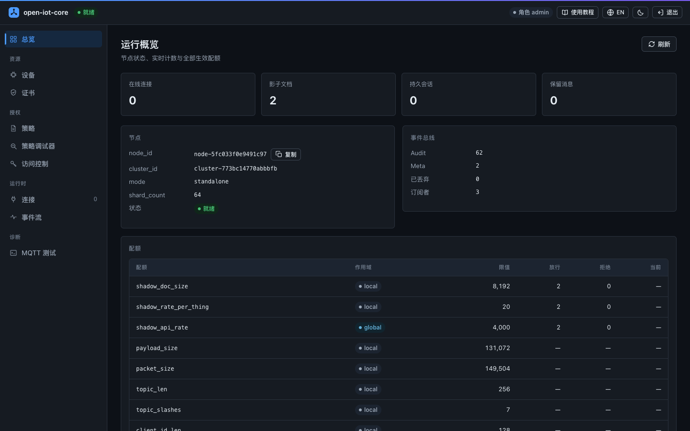
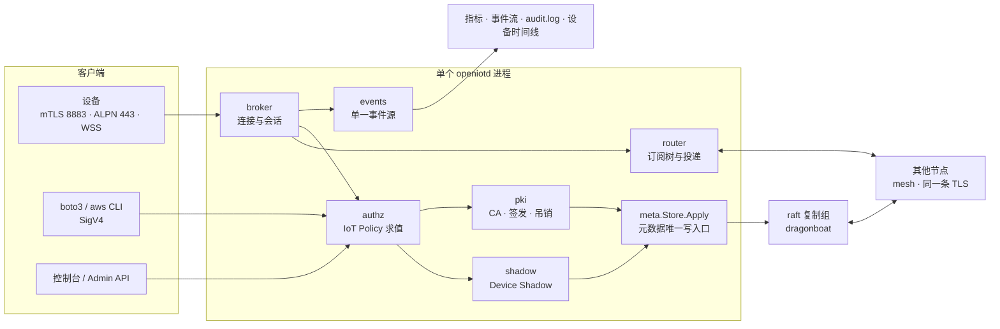

<div align="center">

# open-iot-core

**在自己的基础设施上运行兼容 AWS IoT Core 的设备接入与管理平面。**

MQTT broker、设备注册、证书 PKI、Device Shadow、IoT Policy、AWS 兼容 API
与管理控制台装在同一个静态二进制中，不依赖 Redis、PostgreSQL 或回调服务。

[](LICENSE) [](go.mod) [](#-能力矩阵) [](#-架构) [](https://github.com/itmisx/open-iot-core/pkgs/container/open-iot-core) [](https://github.com/itmisx/open-iot-core/actions/workflows/ci.yml)

**简体中文** · [English](README.en.md)

<sub>Apache-2.0 · 单机与集群同一制品 · linux/amd64、linux/arm64、darwin/arm64</sub>

</div>



<p align="center"><sub>Web 控制台总览</sub></p>

## 为什么是 open-iot-core

| 场景 | 得到什么 |
| --- | --- |
| **从 AWS IoT Core 迁出** | 设备继续使用 AWS IoT Device SDK；`boto3` 与 `aws` CLI 只需改 endpoint |
| **内网、离线或数据不出境** | broker、身份、授权、影子和管理面全部本地运行，不回调云端服务 |
| **不想拼装一套 IoT 平台** | 一个进程内建 MQTT、PKI、注册表、策略、影子、审计、指标与控制台 |
| **需要开源集群能力** | Apache-2.0；元数据、影子、持久会话与离线队列可跨节点复制 |

### 可验证，而不只是一张功能清单

| 验证面 | 仓库内的判据 |
| --- | --- |
| **真实客户端兼容** | AWS IoT Device SDK、`boto3` 与 `aws` CLI 对临时节点实跑 |
| **集群故障恢复** | 三个真实进程，强杀 leader 后重新选举并继续写入；持久会话与离线队列跨节点恢复 |
| **协议与并发正确性** | race detector、确定性模拟、短时 fuzz；MQTT、授权、影子三个严格包覆盖率不低于 95% |
| **控制台可用性** | 真实 Chromium 执行 37 项流程，整轮不允许浏览器错误或未处理的 Promise rejection |
| **合并门禁** | 格式、静态分析、架构契约、race、覆盖率、交叉编译与 fuzz 统一由 `make gate` 执行 |

> [!NOTE]
> 项目目前是 **pre-1.0**，可接入真实设备，但尚无公开生产部署案例。
> 这不是“production ready”声明；正式部署前请阅读[已知边界](#-已知边界)。

## 核心能力

| | |
| --- | --- |
| 📦 **单一二进制** | 无 CGO，控制台经 `go:embed` 编入同一文件。不依赖 Redis、PostgreSQL 或规则引擎侧车 |
| 🔌 **沿用既有 SDK** | `boto3`、`aws` CLI 与 AWS IoT Device SDK 将 endpoint 指向本节点即可使用，无需修改客户端代码 |
| 🔐 **默认即安全** | 强制 TLS、强制鉴权、视图陈旧时对新连接 fail-closed。不安全选项须经三道独立确认闸 |
| 📖 **标准优先** | QoS 2、`sensor/#` 匹配 `sensor`、通配符订阅收 retained、DUP 标志 —— 以上 AWS 未支持或偏离规范之处，本项目均按 OASIS 规范实现 |
| 🧩 **三个直接依赖** | `bbolt`、`yaml/v3`、`dragonboat`。控制台只有 `react` 与 `react-dom` |
| 🪪 **Apache-2.0** | 非 BSL / SSPL / ELv2；集群能力不额外收费 |
| 🔍 **授权可解释** | 策略干跑给出判定结果、命中语句下标、各策略变量的求值结果与放行建议，无需接入真实设备即可验证 |

## 快速开始

使用 Docker Compose 启动单节点，不需要预先执行 `init`：

```bash
git clone https://github.com/itmisx/open-iot-core.git
cd open-iot-core/deploy/standalone/compose
docker compose up -d

# 查看登录控制台所需的管理面令牌
docker compose exec openiotd openiotd admin token
```

控制台位于 **<http://127.0.0.1:9090/>**，MQTT mTLS 端点位于
`127.0.0.1:8883`。数据保存在 Docker volume 中。

从源码运行只需要 Go，不需要 Node：

```bash
go build -o openiotd ./cmd/openiotd
./openiotd init --data-dir ./data
./openiotd cert issue --data-dir ./data --thing dev-001 --policy device-scoped
./openiotd serve --data-dir ./data
```

完整的单机、集群、Docker 与 Kubernetes 路径见[部署](#-部署)。

<details>
<summary><b>🧯 首次连接的常见失败原因</b> —— 返回 <code>NotAuthorized</code> 时先查此处</summary>

<br>

`init` 生成的 `device-scoped` 策略仅放行一条前缀，按设备名收敛：

```
连接   clientId 必须等于设备名
发布   $aws/things/<设备名>/*
订阅   $aws/things/<设备名>/*
```

因此以下两种用法将被拒绝 —— **与 AWS 行为一致，并非故障**：

- `clientId` 填随机值（图形客户端默认如此）；
- 订阅 `sensors/temp` 这类平坦主题 —— 平坦主题无法按设备收敛，任何设备均可读写同一主题，策略变量因此失去意义。

真实原因记录在服务端日志的「连接被拒」/「授权被拒」行中（含动作、资源、判定、命中的语句号与各策略变量的求值结果），
亦可经控制台的**策略调试器**验证，无需接入真实设备。

</details>

<details>
<summary><b>🔧 将 <code>boto3</code> 与 <code>aws</code> CLI 指向本节点</b></summary>

<br>

`endpoint_url` **必须包含 `/api/aws` 前缀**。缺少该前缀时请求会落到控制台首页并返回 HTML，
报错为 `invalid character '<'` —— 该信息不指向真实原因。

region 须在节点的允许列表内；凭据为控制台「访问控制」页签发的 access key。
完整流程见控制台内的**使用教程**（标题栏右侧），正文在 `docs/tutorial/`。

</details>

## 📐 架构



若干贯穿全局的约束：元数据写入的**唯一路径是 `meta.Store.Apply`**（冷层记录与热视图改动随同一条复制日志提交）；
埋点**集中于事件总线一处**，指标在采样闸门之前累加，不由事件流推导；单机写入同样经一副本 raft 组，
故单机与集群共用同一条代码路径。推导过程见 `docs/prd/02-architecture.md`。

## 📦 能力矩阵

> 含糊的兼容性声明比缺少功能更损伤可信度。下表**仅列出已实现、具备测试覆盖且门禁为绿**的部分。

| 域 | 内容 |
| --- | --- |
| 🔡 **协议** | MQTT 3.1.1 与 5.0 全功能；QoS 0/1/2；retained；遗嘱（含 Will Delay Interval）；会话过期；全部 MQTT 5 属性；共享订阅 `$share/` |
| 🔌 **端点** | 8883 mTLS（默认启用）；443 ALPN `x-amzn-mqtt-ca`；443 WSS `/mqtt` + SigV4（后两个默认关闭，不能绑同一个地址） |
| 🔐 **认证授权** | X.509 客户端证书；IoT Policy 含全部策略变量；SigV4（控制面 `iot`、数据面 `iotdata`、WebSocket `iotdevicegateway`） |
| 🪪 **PKI** | 内嵌 CA 签发、CSR 签发、注册自有 CA、证书状态机、吊销后断开在用连接 |
| 👥 **平台** | Device Shadow（经典与命名，含逐叶子 metadata 时间戳与 409 版本冲突） |
| 📇 **注册表** | Thing 增删改查；证书与设备关联；检索（默认关闭） |
| 🤝 **兼容面** | `/api/aws` 下的控制面与数据面 action，将 `aws` CLI 与 `boto3` 指向本节点即可使用 |
| 🛠️ **管理面** | `/api/admin/v1`：连接列举与踢出、SSE 事件流、策略干跑、设备时间线、影子读写、access key 发放、集群成员变更 |
| 🖥️ **控制台** | 总览、设备、证书、连接、策略、事件流、影子、MQTT 测试客户端与旁观、访问控制、使用教程；中英双语；深浅双主题 |
| 📊 **可观测性** | Prometheus `/metrics`（自实现文本格式）；OTLP/HTTP JSON 追踪（默认关闭）；`audit.log`；`events.jsonl` 设备时间线 |
| 🌐 **集群** | 元数据经 dragonboat 多数派复制；消息跨节点 mesh；影子跨节点一致；**持久会话与离线队列经会话分区组复制**；保留消息经 mesh 广播最终一致；Admin 扇出；成员变更不重启；跨节点共享订阅组 |
| 🏗️ **构建** | 无 CGO；交叉编译 linux/amd64、linux/arm64、darwin/arm64；控制台经 `go:embed` 嵌入同一个二进制 |

<details>
<summary><b>⚖️ 与 AWS 刻意不同之处</b> —— 移植时偏差集中之处，逐条列出</summary>

<br>

| 项 | AWS 行为 | 本项目行为 |
| --- | --- | --- |
| QoS 2 | 不支持，请求 QoS 2 时不回 PUBACK/SUBACK | 完整实现 PUBREC/PUBREL/PUBCOMP |
| `sensor/#` 是否匹配 `sensor` | 不匹配（违反 MQTT 规范对 `#` 匹配父层级的要求） | 按 OASIS 规范匹配 |
| 通配符订阅接收 retained | 不支持，须精确匹配主题 | 按规范投递 |
| DUP 标志 | 不支持，重投可能换 packet ID 且不置 DUP | 按规范置 DUP 并保持 packet ID |
| MQTT 5 server redirect `0x9C`/`0x9D` | 不支持 | 支持。这是集群再均衡与滚动升级唯一优雅的手段 |
| 吊销后断开在用连接 | 不保证立即断开 | 断开，**上界是 `max_view_staleness`** |
| 消息顺序 | 不保证消息与 ACK 顺序 | 同一发布者到同一主题在单节点内保序；跨节点保批内有序 |
| 策略干跑与解释 | 无，只能事后翻日志 | 给出判定结果、命中语句下标、每个策略变量的求值结果与放行建议 |
| `DescribeEndpoint` | 返回 ATS 域名 | 返回本节点配置的端点；`endpointType` 接受但语义本地化 |
| 配额默认值 | 云厂商的商业分层 | 默认值对齐 AWS 以保证行为可预期 |
| 证书与设备的关联 | 多对多 | **一对一**，`AttachThingPrincipal` 覆盖原绑定。鉴权路径要用它解析 `${iot:Connection.Thing.ThingName}`，而策略变量只能有一个值 |

</details>

<details>
<summary><b>🚫 明确不提供的能力</b> —— 不列入任何版本的计划</summary>

<br>

| 排除项 | 替代 |
| --- | --- |
| Greengrass 等边缘运行时 | 本项目的单二进制本身可作为边缘节点部署 |
| IoT Analytics / Events / SiteWise / TwinMaker / FleetWise | 各为独立产品，分析由自有系统承担 |
| IoT Wireless（LoRaWAN / Sidewalk） | 无 |
| Device Defender 的 ML 异常检测 | 指标接收端见可观测性一节，检测由自有系统承担 |
| Secure Tunneling | `$aws/things/<设备名>/tunnels/notify` 按普通主题路由，不报错也不做任何隧道语义 |
| Device Location | 无 |
| Device Advisor / Fleet Hub | Fleet Hub 的能力由本项目控制台覆盖 |
| SiteWise 资产模型主题 | 无 |
| Cognito、完整 IAM、STS | 只兼容 SigV4 验签，身份体系是本地 IAM-lite |
| AWS 生态规则 action（lambda、dynamodb、kinesis、firehose、sns、sqs、step-functions、timestream、opensearch、cloudwatch、iot-analytics、iot-events、iot-sitewise、salesforce、location） | 不提供这些 action |
| Commands（`$aws/commands/...`） | 不实现 |
| CloudTrail、Resource Groups、标签计费 API | 本地结构化审计日志 |
| MQTT 以外的设备协议网关（CoAP、LwM2M、MQTT-SN、STOMP） | 不提供。AWS IoT Core 本身亦仅支持 MQTT 与 HTTPS |
| MQTT over QUIC | 非标准扩展。节点间传输可用，不对设备开放 |
| 桥接到其他 MQTT broker | 不作为核心功能提供 |
| 单节点连接密度对标 EMQX | 规划 10–50 万连接/节点，更大规模依赖横向扩展与 TLS 终结外移 |

</details>

## 🚨 已知边界

> [!WARNING]
> 以下不是待办事项，而是**当前部署即会面对的既有约束**。

**数据与一致性**

- **节点挂着期间，发给它上面那些离线设备的消息不再入队**。会话与离线队列本身是跨节点复制的（2026-11-20），节点故障不丢；但入队要求本地路由表里有那个订阅，而订阅只留在设备上次接入的那个节点上。那个节点恢复、或设备换节点重连之后恢复正常（MQTT-128、CLU-111）。
- **保留消息的跨节点同步是最终一致的**。经 mesh 广播而不进共识（2026-11-19），生效窗口是一次广播：A 写完、B 上的订阅者在广播到达前订阅，收到的是旧值或空。广播丢了且该主题此后不再发布时，那个节点会一直缺这一条（看 `retained_broadcast_dropped` 指标）。
- **跨节点的读写可见性是一次复制往返**。跟随者在提交之后异步应用。
- **同一 clientId 的跨节点互斥是最终一致的**，窗口是一次 mesh 往返，不是零窗口。严格的零窗口需在连接路径上等待一次共识，而该路径不允许等待网络。

**可用性**

- **吊销的传播上界等于 `max_view_staleness`**（默认 30 秒；单机为 0），不是「立即」。超过该阈值未追平的节点对**新连接** fail-closed，已建立的连接不被断开。
- **丢失多数派时无法签发、无法吊销**。这是内嵌共识的固有取舍。设备的连接、订阅、收发不受影响，直至触及上述陈旧度阈值。
- **多数派是 `成员数/2+1`**。三节点可容忍一个节点故障；四节点同样仅容忍一个，扩至偶数不提升容错能力；容忍两个节点同时故障需五个节点。

**实现落后于基线**

- **`aws_strict` 尚无配置入口**。「与 AWS 刻意不同」一节所列偏差目前无法退化回 AWS 行为（PRD `CMP-002`、`CMP-003` 要求可退化，实现尚未跟进）。
- **TLS 握手失败没有指标与日志**。客户端证书不是本 CA 签发、ALPN 不匹配、缺少 SNI、握手超时这几种失败，服务端目前不留任何记录（PRD `OBS-021` 未落地）。MQTT 层的连接拒绝与授权拒绝**有**日志记录。

**验证范围**

- **吞吐与延迟没有公开基线**，也不作为合并门禁 —— 不发布无法复现的数字。入库的是内存基线（`docs/baseline/memory.json`）。
- **Kubernetes 清单只在单节点集群上验证过**（Docker Desktop，v1.34.1）：证书与 Secret、PVC 权限、各 Pod 取用自身的复制证书、三节点选举、跟随者写入转发、强杀 leader 后的故障转移、**删掉任意一个 Pod 后它以「重启次数 0」自行恢复**、以及**持久会话与离线队列跨 Pod（含先删掉入队的那个 Pod）**均已验证通过；而**跨故障域部分尚未验证** —— 单节点集群须移除反亲和约束方可运行。详见 [`deploy/cluster/k8s/README.md`](deploy/cluster/k8s/README.md)，那里也记了上一轮写错的那条结论与它暴露的两个缺陷。

## 💻 命令行

```
openiotd init          初始化数据目录、生成 CA 与服务端证书（--if-needed 可反复执行）
openiotd serve         启动节点
openiotd cert issue    签发设备证书并登记
openiotd cert revoke   吊销设备证书
openiotd config print  打印四层叠加后的生效配置
openiotd config env    列出可用的环境变量
openiotd admin token   打印管理面令牌（--rotate 生成新的并替换）
openiotd version       打印版本
```

配置优先级：**默认值 < 配置文件 < 环境变量 < flags**。配置文件中的未知字段
将导致启动失败，而非被忽略。示例配置在 [`examples/openiotd.yaml`](examples/openiotd.yaml)。

> [!NOTE]
> `init` 与 `serve` 是两个步骤，**`serve` 不会自动初始化目录**：因 `data_dir` 填写
> 错误而自动新建空集群的 `serve`，其症状为「所有设备认证失败」，而真实原因无从观察。
> 四份部署清单中的 init 均为编排的前置步骤并带 `--if-needed`，故使用编排时仍是
> 一条命令完成。

## 🐳 部署

`deploy/` 按「单节点 / 集群」分两层，每份均写明提供与**不提供**的内容：

| 清单 | 说明 |
| --- | --- |
| [`standalone/compose/`](deploy/standalone/compose/) | 单节点，`docker compose up -d` 一条命令 |
| [`standalone/docker/`](deploy/standalone/docker/) | 单节点，裸 docker 命令，便于嵌入既有脚本 |
| [`cluster/compose/`](deploy/cluster/compose/) | 单机三节点，用于验证集群行为，**不是**高可用 |
| [`cluster/k8s/`](deploy/cluster/k8s/) | 跨机三节点，**仅在单节点集群上验证过**（跨故障域部分未验证） |

镜像 `ghcr.io/itmisx/open-iot-core`，由打 tag 触发的流水线构建推送，覆盖
linux/amd64 与 linux/arm64，以非 root 运行。本地构建 `make image`。

> [!CAUTION]
> 部署前请先阅读 [`deploy/README.md`](deploy/README.md) 的「开始之前定一件事」：
> **`pki.server_hosts`** 事后变更须重新初始化，而重新初始化
> 等同于更换整条信任链 —— 已签发的设备证书全部作废。集群另有两项硬性约束
> （复制链独立于设备 CA、三节点共用同一套设备 CA）在
> [`deploy/cluster/README.md`](deploy/cluster/README.md)。

## 🔒 安全

**默认配置是安全配置**：强制 TLS、强制鉴权、视图陈旧时对新连接 fail-closed。
不安全的选项必须显式开启，且分为三道**独立**的确认闸，不合并为单一开关 ——
合并后，三项互不相关的风险将由一次确认同时生效：

| 开关 | 确认的是什么 |
| --- | --- |
| `auth.acknowledge_insecure` | 接受完全不认证（`auth.mode: insecure-none`）。该模式下 MQTT 端点绑非回环地址会拒绝启动 |
| `listeners.admin.acknowledge_public_exposure` | 接受将管理面暴露至网络，即便已配置令牌 |
| `listeners.admin.acknowledge_plaintext_key_export` | 接受签发接口经明文 HTTP 回传设备私钥 |

管理面一律要求 Bearer 令牌，不提供「无鉴权」选项。未配置令牌时整个
`/api/admin/v1` 与 `/metrics` **不挂载** —— 请求返回 404，而非一个会响应 401
的版本，后者相当于向攻击者确认此处存在管理面。`/healthz` 与 `/readyz` 始终可用
且不需要令牌。

**数据目录没有应用层加密**：签发 CA 私钥与兼容面 access key 的 secret 均以明文
存放，保护仅为目录 `0700` 与文件 `0600`（`AUTH-092` —— 为简化部署而刻意去掉了
CA 口令）。因此数据目录及其任意一份备份的泄露，等同于泄露整条信任链的签发能力
与全部 access key。需要静态加密请在**卷那一层**实施（dm-crypt、云盘加密、
k8s 的 etcd 静态加密）。

**一处已知的不对称**：`require_sni` 默认为 `false`，而 PRD（`NET-013`、`NFR-040`）
要求默认拒绝缺少 SNI 的连接。自建环境常无 SNI，但默认值与宽松开关当前为同一取值 ——
此为实现与基线的偏差，而非有意的取舍。

🔏 漏洞报告流程与响应时限见 [SECURITY.md](SECURITY.md)。**请勿在公开 issue 中描述漏洞细节。**

## 📚 文档

| 位置 | 说明 |
| --- | --- |
| [`docs/prd/`](docs/prd/) | **需求基线**，18 份需求文档加一份 README 索引，每条需求有稳定 ID。与代码冲突时，代码是缺陷 |
| [`docs/TODO.md`](docs/TODO.md) | 进度对账表，记录「已实现到何处」，不定义「应实现什么」 |
| [`docs/tutorial/`](docs/tutorial/) | 控制台内使用教程的正文（中英两棵树） |
| [`deploy/README.md`](deploy/README.md) | 部署前必读 |
| [`docs/baseline/`](docs/baseline/) | 公开的内存基线数据 |
| [`CLAUDE.md`](CLAUDE.md) | 在本仓库工作的交接说明 |

## 🧪 开发

```bash
make gate      # 合并门禁，必须全绿
make test      # 快速回归
make console   # 修改 web/console/src/ 或 docs/tutorial/ 后必须执行
make sim       # 确定性模拟测试的随机种子深扫
make help      # 全部目标
```

`make gate` = `fmt-check` `vet` `contract` `test-race` `cover-check` `cross` `fuzz-short`。
覆盖率门槛：`internal/mqtt`、`internal/authz`、`internal/shadow` 不低于 **95%**，
整体不低于 **85%**。

门禁**仅依赖 Go 工具链**。依赖 Python、JDK、浏览器或网络的套件置于门禁之外，各自单独执行：

| 套件 | 验证内容 | Make 目标 |
| --- | --- | --- |
| [`tests/device-sdk`](tests/device-sdk/) | 真实 AWS IoT Device SDK 能否连接并收发 | — |
| [`tests/aws-sdk`](tests/aws-sdk/) | 真实 `boto3` 与 `aws` CLI 的控制面与数据面对照 | — |
| [`tests/cluster`](tests/cluster/) | 三个真实进程的集群验收：含强杀 leader、成员变更，以及**持久会话与离线队列跨三个节点** | `make cluster-test` |
| [`tests/console-e2e`](tests/console-e2e/) | 控制台在真实 Chromium 中完整执行一轮，全程不得出现浏览器报错 | `make console-e2e` |
| `tests/examples` | 教程引用的三份 SDK 示例对临时节点实际执行 | `make examples-test` |

贡献前请阅读 `docs/prd/` 中对应的章节：实现不得绕过其中定义的接口契约与行为边界。
**变更行为须同时修改 PRD**（以「实现期补充」小节记录实现阶段方确定的决定）**与 `docs/TODO.md`**。

## 📄 许可与归属

本项目采用 **Apache License 2.0**，全文见 [LICENSE](LICENSE)。
不采用 BSL、SSPL、ELv2 或其他 source-available 许可，集群能力不另行收费。

贡献者协议采用 **DCO**（Developer Certificate of Origin），不采用 CLA。
提交时附 `Signed-off-by` 行即可：

```bash
git commit -s -m "..."
```

### 第三方

运行时的直接依赖共三个，全部纯 Go、不引入 CGO：

| 依赖 | 用途 | 许可 |
| --- | --- | --- |
| [`go.etcd.io/bbolt`](https://github.com/etcd-io/bbolt) | 本地存储引擎（元数据冷层、会话、保留消息、影子） | MIT |
| [`go.yaml.in/yaml/v3`](https://github.com/yaml/go-yaml) | 解析配置文件 | Apache-2.0 与 MIT |
| [`github.com/lni/dragonboat/v4`](https://github.com/lni/dragonboat) | 多节点共识 | Apache-2.0 |

`dragonboat` 另带进若干间接依赖（其日志存储 Pebble 与相关库），其许可可经
`go.mod` / `go.sum` 查验。控制台的运行时依赖只有 `react` 与 `react-dom`。

兼容面的 API 形状参考了 **botocore** 的 service model
(<https://github.com/boto/botocore>,Apache License 2.0,Copyright Amazon.com,
Inc. or its affiliates)。本项目不复制 AWS 文档原文；所有字段与行为的描述文字均自行撰写。

### 商标

本项目与 Amazon Web Services 无隶属关系，未获其背书或赞助。
「AWS」「Amazon Web Services」「AWS IoT Core」是 Amazon.com, Inc. 或其关联公司的商标；
在本项目中出现仅用于说明兼容性，不作为项目名、域名或 logo 元素。
对外表述请使用 **"AWS IoT Core–compatible API"**。
