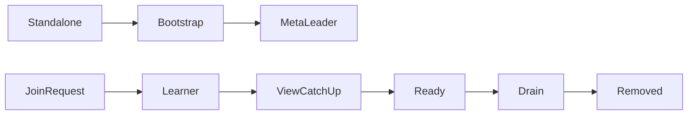

# 03 集群与共识

## 1. 目的

`openiotd` 以同一个二进制支持 standalone、bootstrap、join 三种部署模式。
单节点不是另一套实现，而是副本数为一的集群运行时。
升级到集群不得改变设备 MQTT 接入语义、控制面 API 语义或 Shadow 版本语义。

## 2. 决策：内嵌共识

| ID | 决策 | 状态 |
| --- | --- | --- |
| CLU-001 | 共识内嵌于 `openiotd`，默认配置不依赖外部 etcd、ZooKeeper 或数据库。 | v0.1 |
| CLU-002 | 共识库为 **hashicorp/raft**，日志与标量的落盘是本项目实现在 bbolt 上的（LANG-014、LANG-023 的修订说明）。原文把最终选型推迟到 v0.4，而阶段 B 期间实际跑的是仓库自写的单组 Raft，那套实现缺选举超时与故障转移等四件算法要求的东西，所以选型在 2026-10-31 提前做出。多组（CLU-006 的分区组）仍是未定的那一步，dragonboat 届时重新评估。 | v0.1 **修订（2026-11-19）**：多组那一步到了，共识库改为 **dragonboat v4**，理由与实测数字见 LANG-014 的第二次修订。随之而来的三件事要一并做：节点身份要从字符串映射到 dragonboat 的 `uint64` ReplicaID（映射须显式配置并落进 manifest，不得用哈希——撞了之后两个节点会抢同一个副本号，而症状在日志里看不出来）；raft 日志改由 Pebble 落盘，数据目录里的 `raft/log/store.db` 消失，**既有集群无法原地升级，必须重新 bootstrap**；ARCH-065 里那条「随 dragonboat 进来的 Pebble 单独检查」的隔离规则要同时启用。 |
| CLU-003 | 元数据量达百万级 Thing 时使用 `IOnDiskStateMachine`，快照须流式产出、内存占用与数据量无关，不得先读进内存。bbolt 的 `Tx.WriteTo` 满足该要求且快照即一个可直接打开的库文件。 | v0.1 |

### 2.1 库选型评估

| 库 | 许可 | 多组支持 | 结论 |
| --- | --- | --- | --- |
| lni/dragonboat | Apache-2.0 | 原生 multi-raft | 采用。唯一自带多组调度、共享传输与心跳、Pebble 日志后端的 Go 实现。支持 on-disk 状态机、observer、witness、成员变更、快照。 |
| go.etcd.io/raft | Apache-2.0 | 需自建 | 不用。仅提供共识核心，传输、存储、快照、多组复用全部自写。 |
| hashicorp/raft | MPL-2.0 | 单组为主 | 后备。成熟稳定但多组需起 N 个独立实例与 N 套传输。若放弃分区组仅保留元数据组，它完全够用。 |

CLU-003 的风险缓解：dragonboat 维护集中于单一作者。

**选型表的修订说明（2026-10-31）**：上表只有一列实质对比——多组支持，于是结论
把全部权重压在唯一对 dragonboat 有利的那一轴上，而那一轴的收益要到 v0.4 的
分区组才兑现、成本在引入当天就要付。重做选型时补上的轴是：生产暴露面（十年、
大量部署踩出来的坑已被别人踩过，对共识库而言这是最值钱的属性）、贡献者池
（Go 基础设施人群认 `raft.FSM`/`LogStore`/`SnapshotStore` 这套接口，与 §2.4
同一条理由）、bus factor（RMAP-023 记的正是单一维护者风险）、许可与治理
（hashicorp/raft 是 MPL-2.0，与本项目的 Apache-2.0 相容但不同类；dragonboat 是
Apache-2.0，这一项更干净）、依赖与供应链（见 LANG-014 的实测数字）。结论：
单组用 hashicorp/raft，多组那一步再评估 dragonboat。`go.etcd.io/raft` 的
"不用"结论不变，而且它恰好说明 star 数在这件事上没有判别力——最高的那个
要自建传输、存储、快照与多组调度，正是我们已经自己写过一遍的那些。

**dragonboat 的实测数字（2026-11-19，决策未变更）**：多组那一步临近，于是把
"届时重新评估"里那几个数先量出来。同一条工具链、同样 `CGO_ENABLED=0 -s -w`、
darwin/arm64，以 hello world 为基线：

| 构造 | 二进制 | 相对基线 | 间接模块 | 模块图中的漏洞告警 |
| --- | --- | --- | --- | --- |
| hello world | 1.52 MB | — | 0 | — |
| + hashicorp/raft | 3.90 MB | +2.38 MB | 9 | — |
| + dragonboat（默认 pebble） | 12.13 MB | **+10.61 MB** | 37 | **38** |
| + dragonboat（`plugin/tan`） | 12.30 MB | +10.78 MB | 37 | 38 |

参照：`openiotd` 现在全功能（含控制台）是 10.97 MB，`make vuln` 报模块图中
**1** 条告警。

关于"能不能换掉 pebble"：日志存储**可以**换（`Expert.LogDBFactory` 加
`raftio.ILogDB`，自带 `tan`/`tee`/`chan` 三个实现），但 **pebble 这个依赖换不掉**
——dragonboat 的 VFS 层建在 `pebble/vfs` 上，核心路径就导入它。实测用 `tan` 仍然
链进 25 个 pebble 包，二进制反而大 0.17 MB。

自己在 bbolt 上实现 `ILogDB` 是最差的一条：依赖省不掉（同上），15 个方法全在
正确性关键路径上，而且 `SaveRaftState(updates []pb.Update, shardID)` 是**批量多组**
的接口——dragonboat 的 fsync 合并就发生在这一层，用单写者 B 树去实现它，等于把
换库想换来的那个收益原地交回去。这也正好说明 LANG-023 当初能把 hashicorp/raft 的
`LogStore` 实现在 bbolt 上，是因为那个接口是**单组、逐条**的。

结论不变：收益要到真做出多组并打满才兑现，而成本在引入当天就要付（直接依赖 3 → 4、
间接 9 → 37、二进制约 +8 MB、模块图告警 1 → 38，外加 RMAP-023 的单一维护者风险）。
建议的顺序是先用 hashicorp/raft 做少量组（8 组量级）的分区组原型、拿到实测的 fsync
与心跳数字，再决定要不要为这些成本买单。

### 实现期补充：换共识库（2026-10-31）

阶段 B 至 E 期间的复制组是仓库自己写的（`internal/cluster/memraft.go`，2431 行
实现）。审计它时发现七条缺陷，其中四条是算法要求的组成部分而不是"还没做的
功能"，于是整体换成 hashicorp/raft。下面几条记录换过去之后新定的约束。

| ID | 需求 | 状态 |
| --- | --- | --- |
| CLU-096 | 复制组须有**自动选举与故障转移**：跟随者按超时竞选，leader 故障后剩余多数派须自行选出新 leader 并继续接受写入。这一条单列是因为它曾经缺失且无人发现——自写实现只有 bootstrap 节点在启动路径上竞选一次，跟随者永远不会超时竞选，于是 leader 进程一挂，剩下的多数派写入永久 503；而 `tests/cluster/run.sh` 从头到尾只杀过跟随者，所以该缺陷从未让门禁变红。验收须**杀 leader**（TST-147）。 | v0.1 |
| CLU-097 | 已提交日志由共识组**推**给状态机（`meta.ReplicatedStore.ApplyCommitted`），不得由状态机去拉。拉模型要求实现侧把全部历史命令留在内存里，而每次追平都要整体深拷贝一遍——自写实现的 `Applied()` 正是这样，pump 每 200 毫秒一次，百万条命令时就是每 200 毫秒复制上百 MB。推模型下状态机只看到增量。上层 revision 取 raft 的日志序号，判据是**严格递增**而不是"恰好加一"：成员变更与当选 no-op 也占序号且不进状态机。"少应用一条"的防护随之从"调用方数序号"挪到"库保证按序恰好一次 + 应用失败即停"（`cluster.ErrApplyFailed`：一条已提交的日志应用不了意味着状态机分叉，节点必须停止接受写入而不是跳过它）。 | v0.1 |
| CLU-098 | 状态机快照是「版本字节 + 8 字节 revision + 冷层整库流」，恢复侧据此替换冷层并**从冷层重建热视图**（`registry.HydrateHot`）。revision 必须随快照走：CLU-059 判断三节点是否一致的依据就是它，刚装完快照却报 0 的节点看起来像什么都没追上。重建只改热视图、不写冷层也不提日志——冷层此刻已是权威，再写一遍是把刚装上的整个库重写一次（百万设备下几百 MB 的无用写入），而经写入路径重建更糟：那是把一百万条记录重新提进日志。 | v0.1 |
| CLU-099 | 冷层的句柄须可整库替换（`store.SwapKV`）：装快照就是用另一个库文件替换当前这个，而注册表、会话、保留消息、影子各持一个句柄，直接换掉 `store.Open` 的返回值会让它们继续读一个已被删除的文件，现象是"数据回到了快照之前"。替换顺序是「先落临时文件、再关当前库、再改名、再 **fsync 目录**、再打开」：快照来自网络，一边收一边覆盖目标文件的话，传输中断后旧库已经没了而新库是半份的；而只 fsync 临时文件不 fsync 目录，掉电后"替换成功"在重启之后变成没发生过。 | v0.1 |
| CLU-100 | 节点对外仍只开**一个**端口、只用**一套**证书（CLU-076）：同一个 TLS 监听按连接的第一个字节分流，`R` 交给共识库的传输，`O` 走本项目自己的请求（写入转发、mesh 帧、Admin 扇出）。CommonName 必须等于节点 ID 的校验两个方向都要做；少查一个方向的后果是一个持合法证书的节点可以冒充另一个节点参与投票。写入转发只做**一跳**：收到转发的节点若也不是 leader，直接回 `ErrNotLeader`，再转一次会在两个都以为对方是 leader 的节点之间来回弹。 | v0.1 |

| CLU-101 | 节点被移出成员列表之后，其余节点须把它的通告内容（兴趣过滤器、设备归属、共享订阅组成员数）丢掉。不丢的后果有三条而且都不报错：每条匹配的消息都往一个不在了的节点转发一次（失败只记一条 mesh 事件，看起来像网络抖动）；它承载的设备的消息被转给它而不是在本地查无归属时放弃，消息就此消失；共享订阅组里留着它的成员数，而组内只投一个，轮到它的那些消息没有人补投。判据取 **raft 的成员列表**而不是"最近有没有收到它的通告"：后者会把一次网络抖动当成节点离开，而成员列表是复制状态，各节点看到的一样。 | v0.1 |

### 实现期补充：零窗口围栏为什么不做（CLU-023 至 CLU-025 的完整形态）

TODO 里长期挂着一条"严格的零窗口 epoch 栅栏"。它不是没排上，而是**在当前
架构下不可实现**，这里把理由定下来，免得它继续以"欠账"的形式存在。

要做到同一 clientId 在全集群**零窗口**互斥，接管方必须在 CONNACK 之前
确知没有别的节点同时接管。那需要二者之一：

  - 连接路径上等一次共识（leader 统一发放该 clientId 的所有权）——
    而契约 05 明确禁止在连接路径上等网络/共识，理由是设备上下线是高频
    事件，把它放进复制日志会被连接流量撑爆（阶段 B 已经为此否掉过
    "所有权进日志"）；
  - 或者给每个 clientId 发租约，由持租约的节点独占接管——那要求有一个
    按 clientId 分片的租约持有者，也就是 CLU-008 描述的**分区组**。

所以零窗口互斥与分区组是同一件事的两面，它属于 v0.4 的多组那一步，
不是一条可以单独补上的功能。当前的保证写明如下，并由
`tests/cluster/run.sh` 的围栏用例守着：互斥是**最终一致**的，窗口是一次
mesh 往返（CLU-081）；窗口内两条同名连接可能同时存活，但旧连接在被驱逐
之后无法再写回会话状态（`store.SessionStore` 按 epoch 围栏，
`cluster.ErrStaleEpoch`）。

**跨节点读写的可见性要说清**：跟随者上的生效窗口是**一次复制往返**，不是零。
原先的验收脚本写的是"在 a 上停用，b、c 立刻也不认"，那是自写实现的副作用——
它在 `Propose` 里同步把日志发给每个对端、对端在同一次调用里就应用完。
hashicorp/raft 的跟随者在提交之后异步 apply，所以窗口回到 PRD 本来承诺的
那一个（CLU-049：全集群在 `max_view_staleness` 之内生效）。
依 ARCH-015，它仅出现在 `MetaStore` 与 `ShardStore` 实现体内，替换为模块级改动。

## 3. 组的划分

| ID | 需求 | 状态 |
| --- | --- | --- |
| CLU-004 | 元数据组为单个 Raft 组，3 或 5 个 voter，其余所有节点为 learner 且持有全量数据。 | v0.1 |
| CLU-005 | 节点数超过 voter 配额时，新节点保持 learner，不自动提升。 | v0.1 |
| CLU-006 | 分区组默认 64 个，Shadow 与 JobExecution 按 thingName 分区，retained 按 topic 分区。每组 3 副本，节点数小于 3 时降为节点数。 | v0.1 |
| CLU-007 | Shadow 版本号由分区组的 Raft log index 派生，不使用独立计数器或时间戳。 | v0.1 |
| CLU-008 | 会话归属不写 Raft 日志。由分区 leader 在内存维护，以 Raft term 作为围栏。 | v0.1 |

### 3.1 会话归属的围栏推导

```text
epoch = (raft_term << 32) | leader_local_sequence
```

正确性：

1. 同一 term 内序号由单一 leader 递增，单调。
2. leader 切换后 term 严格增大，即使新 leader 从 0 开始计序号，epoch 仍严格大于旧 term 的任何 epoch。
3. 旧 leader 若因网络分区仍自认 leader 并发放 epoch，其 term 较低，这些 epoch 在契约 01 的校验中被拒，不可能双活授权。

leader 故障转移后新 leader 的归属表为空，处理方式是"未知即允许抢占"。
这是安全的：旧持有者的 epoch 来自更低的 term，在下一次 epoch 校验时被围栏淘汰。
代价是极短窗口内可能重复投递，不会出现双重授权。

| ID | 需求 | 状态 |
| --- | --- | --- |
| CLU-009 | CONNECT 路径上的分布式操作仅为一次到分区 leader 的 RPC，可批量合并，零日志写入、零 fsync。 | v0.4 |
| CLU-010 | leader 变更后各 broker 节点异步向新 leader 重新登记本地活跃会话，用于加速驱逐通知。正确性不依赖该机制。 | v0.4 |

## 4. 元数据后端

| ID | 需求 | 状态 |
| --- | --- | --- |
| CLU-011 | 元数据的 system-of-record 可插拔。读路径不可插拔，始终为本节点内存物化视图。 | v0.1 |
| CLU-012 | 默认且唯一的内置后端为内嵌 Raft。可选外部后端为 PostgreSQL 与 MySQL。 | v0.1 / 可选项 v0.4 |
| CLU-013 | 分区状态（Shadow、JobExecution、Retained）始终内嵌，不得放入 SQL 后端。 | v0.1 |
| CLU-014 | 内嵌模式可选导出只读 SQLite 文件供运维 SQL 直查，不影响单进程部署。 | v0.3 |

### 4.1 后端对比

| 后端 | 额外进程 | 单条写吞吐 | 变更传播 | 评估 |
| --- | --- | --- | --- | --- |
| 内嵌 Raft | 0 | 数千/秒 | tail 复制日志，推送，亚毫秒 | 默认。apply 循环天然驱动视图更新，无需额外的失效通知机制。 |
| PostgreSQL | 外部 | 数千–数万/秒 | LISTEN/NOTIFY 或逻辑复制 | 外部 SQL 后端首选。写吞吐高一到两个数量级，变更推送为原生能力。仅为已有 DBA 运维体系的组织提供。 |
| MySQL | 外部 | 数千–数万/秒 | binlog 订阅 | 为已标准化到 MySQL 的组织提供。 |

### 4.2 为什么读路径不能是 SQL

证书吊销状态在每次 CONNECT 要查，每条 PUBLISH 与 SUBSCRIBE 鉴权也要查，
按 17-quotas.md 的配额为 2 万次/秒量级。任何 SQL 后端在该位置都是数量级不匹配，
不是性能调优问题。契约 05 的内存物化视图因此是地基，不随后端变化。

### 4.3 选用 SQL 后端时的附加要求

| ID | 需求 | 状态 |
| --- | --- | --- |
| CLU-015 | 变更传播的 apply 须幂等并依据单调 revision 判定，以适配至少一次投递语义。 | v0.4 |
| CLU-016 | 外部后端的变更推送须经本节点内部端点转入自有事件总线，再扇出全集群。该链路与"吊销后立即踢连接"共用。 | v0.4 |
| CLU-017 | 须有周期性全量校验补齐，防止变更推送中断导致视图静默过期。吊销状态过期属安全问题，不得仅依赖推送。 | v0.4 |
| CLU-018 | 会话归属的围栏世代改为租约表加条件更新，`epoch = (generation << 32) | local_seq`。要求后端提供强一致条件更新，PostgreSQL 与 MySQL 均满足。 | v0.4 |

## 5. 零外部依赖下的跨节点证书一致性

### 5.1 吊销的端到端流程

```text
1. 运维在任意节点调用 UpdateCertificate(fp, REVOKED)
2. 该节点若非 meta leader，把提案转发给 leader 并代持响应
3. leader 追加命令：Cmd{OpSetCertStatus, Fingerprint, Status, Reason}
4. 多数派 fsync 提交（本地 NVMe 约 1–5 ms；跨可用区约 10–30 ms）
5. 每个节点（voter 与 learner 一致）在自身 apply 循环执行：
     a. 更新热内存视图，revision 取该条日志 index
     b. 写入 bbolt 冷存
     c. 向本地 EventBus 发出 MetaChange 事件
6. 各节点吊销处理器消费本地事件，遍历本节点连接，
   踢掉使用该指纹的会话，DISCONNECT reason 0x87
```

| ID | 需求 | 状态 |
| --- | --- | --- |
| CLU-019 | 吊销的广播由日志复制完成，不得引入额外的跨节点失效通知机制。 | v0.1 |
| CLU-020 | 吊销须立即断开所有在用该证书的活连接。仅改状态不断连视为未完成吊销。 | v0.1 |

### 5.2 两层视图

热路径只需元数据的极小子集，不需要完整 Thing 记录。

```text
热层（内存，鉴权路径只碰这里）
  certStatus    map[[32]byte]CertState     指纹到状态
  certToPolicy  map[[32]byte]policySetID   策略集去重后通常数十到数千个
  policySets    []*CompiledPolicySet       apply 时预编译
  thingHot      map[string]*HotAttrs       仅策略变量实际引用的字段

冷层（bbolt，按需读取，不在热路径）
  完整 Thing 记录、证书元数据、审计
```

| ID | 需求 | 状态 |
| --- | --- | --- |
| CLU-021 | 热视图在百万设备量级的内存占用须在 250 MB 以内（实测 179.5 MB，每设备 188 字节）。基准测试须持续验证。 | v0.1 |
| CLU-022 | 热视图实现为 256 分片加每片独立 `RWMutex`。接口允许后续替换为不可变 HAMT 以实现无锁读。 | v0.1 |
| CLU-053 | 热视图只物化热路径真正读取的字段。证书的到期时间与签发 CA 不入热视图：前者由 TLS 握手校验，后者仅用于审计与控制台，二者均属冷层。 | v0.1 |
| CLU-054 | 设备属性经侧表间接引用而非内嵌切片。切片头即使为 nil 也占 24 字节，百万设备下仅此一项即数十 MB，而策略引用设备属性属少数情形。 | v0.1 |

该预算的构成（实测，百万设备各一张证书与一条设备记录）：

| 组成 | 占用 | 说明 |
| --- | --- | --- |
| 证书表 | 约 96 MB | 键为 32 字节指纹，值 12 字节 |
| 设备表 | 约 29 MB | 键为 4 字节名字引用，值 8 字节 |
| 名字驻留表 | 约 36 MB | 名字只存一份，两表共用 |
| 其他 | 约 19 MB | 缓冲与索引 |

其中约三分之一是 Go map 按 2 的幂扩容造成的槽位浪费：百万条分到 256 片后，
每片 3906 条占满 8192 个槽位，实际装载率约 0.48。预分配无法规避该浪费。
若需进一步压低，手段是改用按快照规模定长的开放寻址表或有序数组加二分查找；
这属于后续优化，不在 v0.1 范围。

### 5.3 视图陈旧须 fail-closed

网络分区中的少数派节点视图冻结在最后提交的 index，可能仍接受在多数派侧已吊销的证书。
托管服务只有一个控制面，不存在该问题；自建场景必须处理。

| ID | 需求 | 状态 |
| --- | --- | --- |
| CLU-023 | 热视图记录最后确认追平时间。超过 `max_view_staleness` 时对新连接 fail-closed。 | v0.1 |
| CLU-024 | 视图陈旧时不得断开已有连接。控制面故障不应放大为数据面全网掉线。 | v0.1 |
| CLU-025 | `max_view_staleness` 默认 30 秒。用户文档须声明吊销的传播上界等于该值，而非"立即"。 | v0.1 |
| CLU-026 | 视图陈旧度纳入节点健康检查，并在控制台集群视图展示各节点视图版本偏差。 | v0.1 |

### 5.4 CA 私钥不进 Raft

| ID | 需求 | 状态 |
| --- | --- | --- |
| CLU-027 | 进入 Raft 的仅为公开数据：已签发证书的公钥部分、证书状态、绑定关系、策略。 | v0.1 |
| CLU-028 | CA 私钥、设备私钥、claim 证书私钥不得写入 Raft 日志、WAL 或快照。 | v0.1 |
| CLU-029 | 签发为特权角色。`--role` 含 `signer` 的节点持有签发密钥；其余节点收到 CSR 后转发。 | v0.2 |
| CLU-030 | 签发密钥后端可选 file、pkcs11、kms。生产建议后两者——file 后端不做静态加密（AUTH-092），私钥以 PEM 落盘，靠 0600 保护。 | v0.2 **修订（2026-11-20）**：启动模式 `bootstrap` 更名为 `cluster`，取通俗。区别不变：`cluster` 带着 `peers` 作为初始成员建组，`join` 只写自己、由现有 leader 调 `POST /cluster/members` 把它加进来。项目尚未发布，不留旧名。 |

## 6. 节点生命周期



| 阶段 | 行为 |
| --- | --- |
| standalone | 无 peers 时初始化一副本 meta group 与固定 shard layout |
| bootstrap | 创建新集群，仅可在空 data dir 执行；写入 cluster ID、初始成员、不可变 shard count |
| join | 以 bootstrap token 与集群 CA 建立内部 mTLS；先作为 learner 复制快照与日志 |
| ready | 本地 view revision 追平 leader commit revision 后，才监听设备流量 |
| promote | 健康 learner 可提升为 voter。默认 3 或 5 voter，其余保持 learner |
| drain | 停止新连接，MQTT 5 客户端收到 server redirect；本地连接清空后移出成员 |
| remove | 由 quorum 提交成员变更；被移除节点停止 mesh 与 Raft 服务 |

| ID | 需求 | 状态 |
| --- | --- | --- |
| CLU-031 | 启动须拒绝：data dir 中 cluster ID 与配置冲突、已存在 data dir 再执行 bootstrap、shard count 不一致、join 模式无 seed peer、重复 node ID。 | v0.1 |
| CLU-032 | 节点在 ready 之前不得监听设备端口，避免半空视图导致误拒或误放。 | v0.1 |
| CLU-033 | `node_id`、cluster ID、`shard_count` 持久化于 data dir manifest，运行中与重启后不可变。 | v0.1 |
| CLU-055 | `serve` 遇到未初始化的 data dir 须报错并提示先执行 `init`，不得自动初始化。一个因为 `data_dir` 打错而自动新建空集群的 `serve`，症状是"所有设备认证失败"，而真因（连错目录）完全看不出来。 | v0.1 |
| CLU-056 | manifest 须带 `format_version` 且原子写入（临时文件加 rename 加 fsync）。身份文件损坏意味着该节点无法再启动。 | v0.1 |
| CLU-057 | manifest 的 `format_version` 高于本程序支持的版本时须拒绝启动并提示升级，不得按旧字段语义解释新格式。 | v0.1 |
| CLU-058 | 进程内多节点日志按多数派提交。丢掉多数派时新命令拒绝，已提交的命令仍可从本节点读出。单机元数据写入仍走一副本组。阶段 B 的跨进程与 mTLS 完成前不得宣称高可用（CLU-049）。 | v0.1 |
| CLU-059 | 进程内日志可截成快照。空白节点先装快照再接后续条目，更旧的快照不得覆盖已提交序号。跟随者的写入转到 leader（CLU-037）。三个节点把已提交命令应用到各自视图后，revision 与设备集合一致。 | v0.1 |
| CLU-060 | 提交前把日志写入节点目录。三个进程用 TLS 互连，证书 CommonName 必须是节点 ID，对不上就丢掉这次调用。多数派还在时写入成功；只剩一个节点时写入失败，已提交的仍能读到。空白节点靠快照追平。`openiotd serve` 仍按单机启动，不能把单机进程说成高可用部署。 | v0.1 |
| CLU-061 | 只有 leader 发放 clientId 的 epoch。任期升高后新 epoch 严格大于旧任期的任何值，旧 epoch 不能释放这份所有权。同一键始终落到同一分区。影子和保留消息的版本取提交序号，序号不前进就拒绝。 | v0.1 |
| CLU-062 | 跨节点兴趣只保留带通配符的过滤器。发往对端的帧队列有硬上限，放不下时整批拒绝，队列不再变长。 | v0.1 |
| CLU-063 | 节点排空后拒绝新写入，已提交的命令仍可读取。日志文件可以备份再恢复。 | v0.1 |

## 7. 配置模型

```yaml
node:
  id: ""                        # 空时首次启动生成并持久化
  mode: standalone              # standalone | bootstrap | join
  role: [broker]                # broker | signer
  data_dir: ./data
  advertise_addr: 10.0.0.11:7946
  mesh_addr: 10.0.0.11:7947
  seeds: []                     # join 模式必填
cluster:
  shard_count: 64               # 集群创建后不可变
  voters: 3
  max_view_staleness: 30s
meta:
  backend: embedded             # embedded | postgres | mysql
  embedded:
    sqlite_view: ""             # 非空时导出只读 SQLite
view:
  resync_interval: 30s
tls:
  internal_ca_file: ./data/pki/cluster-ca.pem
```

| ID | 需求 | 状态 |
| --- | --- | --- |
| CLU-034 | 支持 YAML 文件与等价 flags，后者优先级更高。 | v0.1 |
| CLU-035 | 设备监听地址可变更；advertise 与 mesh 地址变更须经成员变更 API 发布。 | v0.4 |

## 8. 内部协议

### 8.1 元数据命令

| ID | 需求 | 状态 |
| --- | --- | --- |
| CLU-036 | 每个命令带 `command_id`、`kind`、`key`、`payload`、`requested_revision`。状态机对相同 `command_id` 幂等。 | v0.1 |
| CLU-037 | 成功响应携带 Raft log index 作为 revision。follower 的写请求转发至 leader。 | v0.1 |

### 8.2 消息 mesh

| ID | 需求 | 状态 |
| --- | --- | --- |
| CLU-038 | 节点间使用 mTLS 长连接。帧含协议版本、源节点、消息 ID、topic、QoS、payload、可选目标集合。 | v0.4 |
| CLU-039 | mesh 须提供有界发送队列、按 topic 批量、背压信号、QoS 1 重试。不得因慢节点无限积压内存。 | v0.4 |

### 8.3 运维 API

| ID | 需求 | 状态 |
| --- | --- | --- |
| CLU-040 | Admin API 提供 cluster status、join token、CA 下发、members、promote、drain、remove、transfer leadership、backup、restore。 | v0.4 |
| CLU-041 | 跨节点列表使用不透明分页游标，响应可返回 `partial=true` 与未响应节点清单。 | v0.1 |

## 9. 失败模式

| 场景 | 证书与元数据 | 设备数据面 |
| --- | --- | --- |
| meta leader 故障 | 写阻塞约 1 秒（选举超时） | 无影响，视图为本地 |
| 丢失 meta quorum | 无法签发、无法吊销 | 连接与收发正常，直到触及陈旧度阈值后新连接 fail-closed |
| 少数派分区 | 视图冻结，吊销不可见 | 现有连接正常；超过 `max_view_staleness` 后拒绝新连接 |
| 分区组失去 quorum | 受影响 thing 的 Shadow 写拒绝 | 消息收发正常。故障域限制在 1/64 key 空间 |
| 节点磁盘损坏 | 移出成员后重新加入并拉快照 | 其上连接断开，设备重连至其他节点 |
| 新节点加入 | learner 拉快照加追日志 | 追平前不接受设备连接 |
| signer 节点全部不可用 | 无法签发新证书 | 无影响；吊销仍可进行（不需私钥） |
| 滚动升级 / 腾空节点 | 无影响 | MQTT 5 server redirect 优雅迁移；MQTT 3 客户端走限速断开 |
| 偶数节点集群 | 引入 witness（只投票不存数据）避免 quorum 浪费 | 无影响 |

| ID | 需求 | 状态 |
| --- | --- | --- |
| CLU-042 | 丢失 quorum 时无法吊销，是内嵌共识的固有取舍，须在用户文档明确声明。 | v0.1 |

## 10. 单机到集群的迁移

| ID | 需求 | 状态 |
| --- | --- | --- |
| CLU-043 | 发布先引入集群 runtime 但默认 `standalone`，使现有部署经相同 runtime 启动。 | v0.1 |
| CLU-044 | 迁移前须为每节点设置稳定 data dir 并验证 node ID。禁止以临时目录直接升级为集群。 | v0.4 |
| CLU-045 | 迁移流程：备份单节点 meta/shard 数据，在原节点以 `bootstrap` 创建一副本集群，新节点按 learner 加入，确认 view revision、证书策略热读、mesh 健康后接入负载均衡器，三个 voter 健康后移除旧拓扑。 | v0.4 |
| CLU-046 | 未提交的控制面写可重试。已提交 Raft revision 不回滚，只能以新命令补偿。 | v0.1 |
| CLU-047 | `shard_count` 变更须经导出、重建集群、导入完成，不支持在线重分片。 | v0.4 |

## 11. 分阶段交付与验收

| 阶段 | 交付 | 验收 |
| --- | --- | --- |
| A 节点基础 | 模式、data dir、manifest、node identity、readiness | 重启 ID 不变；无效配置拒绝启动；未 ready 节点拒绝监听设备端口 |
| B 元数据复制 | meta Raft、快照、leader 转发、view apply | 3 节点写入后各节点 revision 一致；丢 quorum 时读可用写拒绝 |
| C 分区与围栏 | shard layout、Shadow/retained Raft、term epoch | leader 切换后版本单调；同 clientId 不双活 |
| D 消息 mesh | mTLS、兴趣传播、批量、背压 | 跨节点 QoS 0/1 投递；慢节点不耗尽内存；节点丢失边界可观测 |
| E 运维 | ctl 与 Admin、drain、backup、故障注入 | learner 加入、滚动升级、分区恢复、磁盘重建均经脚本验证 |

| ID | 需求 | 状态 |
| --- | --- | --- |
| CLU-048 | 每阶段须有单元测试、进程内集成测试、至少一个真实多进程场景。 | v0.4 |
| CLU-049 | 阶段 B 完成前不得对外宣称具备高可用集群能力。 | v0.1 |

## 12. 可观测性与内部安全

| ID | 需求 | 状态 |
| --- | --- | --- |
| CLU-050 | 所有成员变更与 Raft role 变更写入审计事件。 | v0.4 |
| CLU-051 | 指标须含 view revision 与 lag、ready 状态、Raft leader、quorum 状态、mesh 队列深度、消息重试、ownership 接管次数、epoch 拒绝次数。 | v0.1 |
| CLU-052 | 内部服务在 join 之前以 bootstrap token 交换短期节点证书；运行期 RPC 均使用 mTLS 并校验 node ID SAN。 | v0.4 |

## 元数据复制的落地（实现期补充）

下面这些是 v0.4 阶段 B 真的接到 `openiotd serve` 上时定下的。写成需求是
因为它们每一条都对应一次实测失败，而失败的样子都不指向真因。

| ID | 需求 | 状态 |
| --- | --- | --- |
| CLU-064 | 复制日志里的命令须有显式线格式，且**传策略文档而不是编译产物**：编译结果是宿主语言里的一棵匹配器，序列化之后在另一个节点上还原不出来。各节点拿同一份文档各自编译。线格式须带版本号，读到更高的版本明确报错——一条解不全的命令被应用之后，这个节点的视图与别人的就不一样了，而没有任何报错。 | v0.1 |
| CLU-065 | 冷层记录须与热视图的改动放在**同一条已提交日志**里。只复制热视图的话，跟随者上鉴权能过，而 `GetThing`、证书正文、策略正文全是空的——空白节点靠快照追平之后看起来是追上了，控制面读出来却什么都没有。计数器的推进（REG-112 的策略集编号）同样要进日志：各节点各自读-改-写会把同一个编号分配两次，而编号正被证书与设备记录引用着。 | v0.1 |
| CLU-066 | 解不开的已提交日志条目须让追平失败，不得跳过。跳过的后果是本节点的视图比别人少一条变更，而没有任何报错。 | v0.1 |
| CLU-067 | 单副本与多副本共用同一个状态机：命令的校验、应用、冷层写入、变更发布都是同一份代码，区别只在命令是直接追加还是先过共识（ARCH-057）。 | v0.1 |
| CLU-068 | 集群内部互信是与设备 CA 无关的一条独立信任链，配置项分开。共用的话，拿一张设备证书就能冒充节点——等于把元数据写入权发给了任何一台设备。 | v0.1 |
| CLU-069 | 复制证书的 CommonName 必须等于节点 ID（握手时校验），SAN 须含拨号侧用的主机名。节点身份由 CommonName 单独认，不靠主机名。 | v0.1 |
| CLU-070 | `node.mode` 是 standalone 而写了复制组配置须**报错**，不是忽略。那份配置看起来像在跑集群而进程其实是单机——「不能把单机进程说成高可用」（RMAP-004）只有在配置层面也拦住才守得住。 | v0.1 |
| CLU-071 | 跟随者上的写入在 Propose 成功之后还要等本节点应用了那条日志才能返回 revision：提交与「本节点看到」之间隔着一次网络往返。不等的后果是从跟随者写入返回 500，而那条数据其实写成功了。 | v0.1 |
| CLU-072 | 控制面不得为「策略名到编号」另留一张内存映射。集群下它立刻成为第二个真相：跟随者的热视图与冷层都靠日志追平，而那张映射只在本节点自己写入时更新——于是在跟随者上建设备会说「策略不存在」，而那份策略明明在冷层里。权威是冷层记录（编号）加热视图（编译结果）。同一类教训在订阅状态上吃过一次（MQTT-105 至 MQTT-107）。 | v0.1 |
| CLU-073 | 「此刻提交不了日志」须映射为 503，不是 400。请求完全合法，是这个节点丢了多数派、正在排空或还没选出 leader；400 会让调用方去改请求，而它该做的是重试或换个节点（API-089）。 | v0.1 |
| CLU-074 | 集群模式下，文件化注册表只由 bootstrap 节点导入一次。三个节点各自导入会把同一份策略写进日志三次——幂等键不同，状态机认不出它们是同一件事。且导入要等到选举完成之后：它是一次写入，而启动时还没有 leader。 | v0.1 |

## 恢复路径：applied index 与热视图（实现期补充，2026-11-19）

换共识库时查出来的两条前置改动。两种库的恢复模型是相反的：
hashicorp/raft 重启时把整条日志推给状态机，而 dragonboat 的
`IOnDiskStateMachine` 只推 applied index 之后的那一段——更早的已被快照
压掉。这一对改动把恢复路径换成后者要的那种，而它在前者上同样正确
（重放变成空操作），因此可以先行落地、独立验证。

| ID | 需求 | 状态 |
| --- | --- | --- |
| CLU-109 | 元数据的 applied index 须随冷层一起落盘，并在启动时读回。写入顺序是判据而不是风格：**先写记录、再写 applied index**，两次都 sync。崩在中间留下的是「index 偏旧」，那一条会被重放一遍，而冷层写入是覆盖语义，重放一遍与应用一遍结果相同；反过来写留下的是「index 偏新、记录没落盘」，那一条**永远不会被重放**，表现是重启后控制面少一条记录而不报错。每条命令都要写，哪怕它没有冷层记录——不写的话 index 落在后面，日志压不掉，而压不掉要到快照那一步才显形。键由装配层注入（`meta` 不认识冷层的键空间，ARCH-065），且与冷层记录**在同一个库**里：它必须与它所描述的那些记录一起被快照、一起被恢复。**只在集群模式下启用**：单机的 revision 来自 `SingleReplica` 的日志序号，而那个日志每次重启从 0 起，把盘上的值喂给它会让视图 revision 倒退。 | v0.1 |
| CLU-110 | 集群模式下启动时须用 `HydrateHot` 从冷层重建热视图，不得依赖重放日志。它与 CLU-109 是**一对**：只上 CLU-109 的话，已应用的日志被跳过而热视图原先正是靠重放那一段建出来的，结果是控制面空着、设备全部连不上；只上本条则是重建完又被重放盖一遍，白做功但不出错。顺带的收益是重启时间从「与日志长度成正比」变成「与冷层大小成正比」——这一条不换库也成立。 | v0.1 |

## 保留消息的跨节点同步（实现期补充，2026-11-19）

判据在 MQTT-122 至 MQTT-126，这里只记落在集群侧的两条。

| ID | 需求 | 状态 |
| --- | --- | --- |
| CLU-107 | Raft 快照安装之后须重载内存里的保留消息。冷层、会话与 retained 在**同一个** bbolt 里，而快照安装是整库替换（CLU-099）；`LoadInto` 只在启动时跑一次。于是跟随者装完快照后，磁盘上的 retained 已经是 leader 的而内存里还是自己的——这个不一致今天就存在，只是 retained 不跨节点所以没人看得见，接上之后它的表现是「重启后 retained 变了」。 | v0.1 |
| CLU-108 | 新对端出现时的全量 dump 由通告循环 diff `Peers()` 驱动：mesh **没有**「对端已连上」回调，而通告循环本来就每个周期跑一次。两端各自 diff 自己的对端集合，因此 dump 天然是双向的——这同时让重启后计数器落后的节点被对端的 dump 抬上来（MQTT-123 的接收规则）。dump 须分片发送，不得一条消息装下整个 retained 集合。 | v0.1 |

## 消息面的落地（实现期补充，阶段 D）

| ID | 需求 | 状态 |
| --- | --- | --- |
| CLU-075 | 设备归属（哪台设备连在哪个节点）与订阅兴趣都以**全量快照**周期性通告，整体替换而非增量。快照是幂等的：通告丢一次或乱序都不会让状态永久偏离，不需要重传与确认。当前编码是全量名字列表，到百万设备要换成摘要（ARCH-047 把编码留作可延后的实现细节）。换摘要时假阳性可接受（对端找不到订阅者就丢掉），**假阴性不可接受**——它会让消息静默丢失。 | v0.1 |
| CLU-076 | 消息面复用复制组那条 TLS 连接，不另开端口、不另发一套证书。节点之间只有一条互信通道，上面跑多种消息（选举、日志、消息帧、兴趣通告、设备归属）。另开一条的代价是运维要配两个端口两套证书，而安全边界完全一样。 | v0.1 |
| CLU-077 | 从别的节点收到的帧只投本地订阅者，**不再转发**。发布侧已经算过一次远端集合，接收侧再转一次会在两个互相有兴趣的节点之间无限弹。 | v0.1 |
| CLU-078 | 控制台的 MQTT 测试客户端与抓包的订阅同样参与兴趣通告。它们走的就是 `Router.Subscribe`，不参与的话多节点下控制台只能看到本节点的流量，而用户无从知道自己漏看了什么。 | v0.1 |
| CLU-079 | 帧格式版本不认识时丢弃并计数，不得尽力解析。一条字段含义变了的帧被当成正常消息投给设备，比丢掉它更坏。 | v0.1 |
| CLU-080 | 设备域主题在本节点与远端都查不到归属时**不转发**。随便挑一个节点转过去只会让消息在那边被丢掉，而发布者以为投出去了。 | v0.1 |

## 会话围栏与影子（实现期补充，阶段 C/D 收尾）

| ID | 需求 | 状态 |
| --- | --- | --- |
| CLU-081 | 节点接管一个 clientId 之后须通知其他节点，收到通知的节点断开本地同名连接。这是**最终一致的互斥**：窗口是一次 mesh 往返，不是零。严格的零窗口要求连接时等一次共识（epoch 由 leader 统一发放），而设备上下线是高频事件——把它放进复制日志会让日志被连接流量撑爆，也会在连接路径上多一次 RPC（契约 05 刚好禁止这件事）。通知在连接路径上只入队、不阻塞；队列满时丢弃并计数，因为让 CONNECT 等在一个满队列上会把整批设备卡死。 | v0.1 |
| CLU-082 | 影子命令随元数据组的**同一条复制日志**走，各节点在 apply 阶段用同一份 `shadow.ApplyCommand` 状态机算出同样的结果。不选「按 thingName 分区 + 转发」是因为故障语义：分区要有副本就得每分区一个 raft 组，而单副本分区在归属节点永久故障时直接丢掉那部分影子，违反 SHDW-070。命令进日志则每个节点都有全量影子、读在本地、任一节点挂掉不影响别人；代价是写入吞吐受单组限制，要更高吞吐再叠加分区。 | v0.1 |
| CLU-083 | 影子的版本冲突（409）是**确定性的状态机结果**，不是 apply 失败：给定同样的日志前缀，所有节点都算出同样的冲突。当成失败会让 apply 返回错误而日志已经提交，于是日志与状态不一致。冲突经幂等键交回发起方；真正的存储故障仍要让 apply 失败。 | v0.1 |
| CLU-084 | 带影子载荷的日志条目必须有幂等键：发起方靠它取回本节点算出的结果。没有键的话命令会被应用而发起方永远拿不到结果——那是一次「看起来超时了但其实成功了」的写入。 | v0.1 |
| CLU-085 | 影子命令的线格式须保住数字字面量（SHDW-026a、SHDW-073）：经过 `json.Marshal(any)` 会让 `1.50` 变成 `1.5`、大整数丢精度，而影子是设备与云之间逐字段比对的契约。 | v0.1 |

## Admin 扇出（实现期补充，契约 12）

| ID | 需求 | 状态 |
| --- | --- | --- |
| CLU-086 | 控制台的「列出在线连接」须跨节点聚合。只看本节点会给出一份**看起来完整而其实少了大半**的列表，而用户无从知道自己漏看了什么。扇出并发发出，耗时是最慢那个节点的而不是累加；本节点直接走本地处理函数，不绕一圈网络。 | v0.1 |
| CLU-087 | 扇出游标须编码**每个节点各自的位置**（ARCH-040）。单一 offset 下合并分页无法正确推进：各节点的行数不同，按一个全局偏移翻页会跳过某些节点的行、重复另一些。空游标要编成空串，不得变成一个看起来有内容的 token。 | v0.1 |
| CLU-088 | 单个节点失败须表达为**部分失败**（ARCH-041）：响应里标出 `partial` 与失败的节点清单，整体仍返回成功。运维工具在故障时必须仍然可用，那正是最需要它的时刻；而不标出来的话调用方会把一份不完整的列表当成全部。 | v0.1 |
| CLU-089 | 扇出的行以字节传输，传输层不认识任何具体查询的行类型。认识的话它就得随每个新查询改一次，而 gob 还要求注册每个具体类型。 | v0.1 |

## 成员变更（实现期补充，CLU-050 的落地）

| ID | 需求 | 状态 |
| --- | --- | --- |
| CLU-090 | 成员列表是 raft 自己的状态，不是配置里的静态表：它决定多数派的分母，而按一份过期的成员算多数派正是脑裂最直接的来路。变更作为日志条目复制，**提交之后才生效**——提前生效会让分母在这条日志还可能被覆盖时就变了。成员条目带地址，于是新加入的节点不必出现在别人的配置文件里。配置里的 `peers` 退化为「初始成员」，只在日志为空时使用。 | v0.1 |
| CLU-091 | 一次只允许一个成员变更在途。Raft 的单步变更在两次变更同时在途时会脑裂（新旧配置的多数派可能不相交），等上一次提交之后再开始就安全。没提交成的变更须撤掉在途标记，否则这个 leader 以后再也提不了变更，而集群卡在「改不了成员」且没有任何报错。 | v0.1 |
| CLU-092 | 当前成员列表须随 raft 状态一起落盘，不能只靠重放日志。成员变更可能发生在已被压缩进快照的那一段，那时日志里再也找不到它——只靠重放的实现会把成员退回初始配置。 | v0.1 |
| CLU-093 | 快照须带上成员列表。空白节点若按自己配置里的成员算多数派，就可能以为「成员只有我」而选自己当 leader——两个 leader 同时提交。 | v0.1 |
| CLU-094 | 成员变更是管理面写操作：要管理面令牌、写审计。它把元数据写入权发给一个新节点，等级与签发证书相同。「不是 leader」「上一次还没提交」「没有多数派」都映射为 503（请求合法，此刻做不了）；「已经是成员」「不是成员」「移除最后一个」是 409。 | v0.1 |
| CLU-095 | 日志条目的每一条复制路径（内存克隆、线格式、落盘往返）都须带上条目的全部字段，并有逐字段的断言盯住。这是实测犯过的错：`raftEntry` 加了成员变更字段之后三处复制都忘了带，表现是**跟随者永远看不到成员变更**——它们继续按旧成员算多数派，而没有任何报错。 | v0.1 |

## 复制链的主机名校验（实现期补充）

| ID | 需求 | 状态 |
| --- | --- | --- |
| CLU-102 | 拨号侧**不得**对对端证书的 SAN 有任何要求：节点身份按 CommonName 认（CLU-069），复制地址可能是 IP、也可能在 k8s 里随 Pod 重建而变。要真的不校验主机名只能走 `InsecureSkipVerify`，而那个开关一开，Go 既不建链也不填 `verifiedChains`——**链的校验必须自己补上**（用复制 CA 建链再比 CommonName），否则任何一张自签证书都能冒充节点，正是 CLU-068 要防的那件事。由来：原先的写法是把 `ServerName` 钉成 `"localhost"` 再配一个只比 CommonName 的回调，那并没有关掉主机名校验，于是**每张节点证书的 SAN 里都必须含 `localhost`**，而这条隐含要求没有写在任何需求里。 | v0.1 |
| CLU-103 | 复制链的证书装置（验收脚本、部署清单、包内测试）**不得**给节点证书签上拨号时用的主机名。签了就会把 CLU-102 那一类缺陷盖住：`tests/cluster/run.sh` 与 `deploy/cluster/compose/gen-certs.sh` 当时都签了 `DNS:localhost, IP:127.0.0.1`，包内的 `writeNodeFiles` 也是，于是三处装置与实现带着同一个假设，三节点验收一路绿，而 k8s 的清单（复制证书只含 Pod 的 DNS 名）在选举阶段全部握手失败。判据：**SAN 与拨号用的名字必须对不上**，这样才真的在验「按 CommonName 认身份」。 | v0.1 |

### 由来

这两条是把 k8s 清单第一次放到真集群（Docker Desktop 的单节点）上跑出来的。
三个 Pod 一致地报「元数据组在 15s 内没有就绪（选举未完成或对端不可达）」，
而那条错误指向网络——TCP 通、DNS 通、证书挂对了、CommonName 也对。
真因只在把复制组的日志调到 DEBUG 之后才看得见：

```
raft: failed to make requestVote RPC: target="{Voter openiotd-2 ...}"
  error="tls: failed to verify certificate: x509: certificate is valid for
  openiotd-2, openiotd-2.openiotd-peers, ..., not localhost"
```

教训与 AUTH-077（SigV4 规范路径）是同一个形状：**凡是靠对端复现的规则，
自己造的装置与实现共享同一个假设时，用例没有证明力。** 那次的判据是真 SDK，
这次的判据是「SAN 与拨号名字对不上的证书」。

## init 的幂等执行（实现期补充）

| ID | 需求 | 状态 |
| --- | --- | --- |
| CLU-104 | `init` 须有一个可反复执行的形态（`--if-needed`）：已经做过的部分跳过，整体以成功退出。这不放宽 CLU-055——那条禁止的是 **`serve`** 自动初始化，理由是 `data_dir` 打错时会静默新建一个空集群；`init` 仍是一个显式步骤，只是让编排能反复执行它。判据是**按步骤跳过，不是按身份文件跳过**：三份部署清单此前各自写了一段 `if [ -f manifest.json ]` 的 shell 守卫，它看见身份文件就跳过全部步骤，于是一个只建到一半的目录（典型来路是上一次在签服务端证书那一步中断，身份与策略已写下而 PKI 没有）永远补不齐，而下一次启动看起来是正常跳过的。另外「已存在」须是可判别的哨兵错误而不是一句文本：靠匹配文案去分辨「已经做过」与「真的失败了」，文案一漂移，编排就会把一次真失败当成已完成继续往下走。 | v0.1 |
| CLU-105 | 编排清单里的初始化步骤**不得**用手写的 shell 守卫去绕开 `init` 的不幂等。同一段守卫在三处手工重复，而它们的正确性没有任何测试覆盖；守卫一旦与 `init` 的实际步骤脱节（新增一个初始化步骤时必然脱节），表现是那一步在所有已有部署上永远不执行，且没有任何报错。 | v0.1 |
| CLU-106 | 部署清单的初始化步骤须把 `pki.server_hosts` **经配置文件**传给 `init`：服务端证书的 SAN 只在 `init` 的那一次签出（`serve` 从不重签），而这一项没有等价的命令行开关，所以一个不挂配置的 `init` 签出的 SAN 是默认的 `localhost`/`127.0.0.1`。由来：`deploy/cluster/compose` 的 init 服务不挂配置，而 `node-*.yaml` 里那张含三个服务名的 `server_hosts` 从未被用上——它看着生效，实际是装饰；表现是设备在 compose 网络里按 `node-b:8883` 连就报主机名不匹配，而 TLS 握手失败既无指标也无日志（`OBS-021` 未落地），两头都不指向证书的 SAN。同时**不得**把带 `node.mode: bootstrap` 的节点配置直接挂给 `init`：bootstrap 要求数据目录为空（CLU-031），第二次 `docker compose up -d` 会以身份冲突失败，而 `--if-needed` 只吞「PKI 已存在」（CLU-104），吞不了这一条——须单放一份只含 `pki` 段的配置。推论：既然这张表只对 `init` 有效，节点配置里就不该再写 `server_hosts`，两处都写只会悄悄漂移（文档分层的同一条理由）。 | v0.1 |

### 为什么把它记成需求

提问是「单节点非要先跑一次 init 吗，不能让程序默认做掉吗」。答案的两半
都要写下来：**`serve` 不会自动初始化**（CLU-055，理由没变），但
**使用者不该为此多敲一条命令**——那一步属于编排，而编排需要它幂等。
原先三处清单用 shell 守卫凑出幂等，是把一个属于程序的性质外包给了
部署清单，于是同一件事写了三遍、还都没有测试。

## 会话与离线队列的组内复制（实现期补充，2026-11-20）

这一节解决的是 v0.3 之前最大的一处「看起来是集群、其实不是」：会话与
离线队列只落在接入它的那个节点的盘上。设备连到另一个节点就是一个新
会话（订阅没了），节点死掉时它的离线队列跟着没。

| ID | 需求 | 状态 |
| --- | --- | --- |
| CLU-111 | 会话与离线队列须经**分区组**复制：按 `clientId` 哈希分到若干条独立的 raft 日志上（默认 8，`cluster.replication.session_shards`），与元数据组共用同一个 NodeHost。不与元数据合用一条日志：元数据的写入是人工操作的频率，会话的写入跟着消息走，合用时后者会把前者挤死。分片数**一经初始化不得更改**——分片号参与键的归属判定，改了之后既有会话会被算到别的分片上，而那条日志里没有它们，症状是「一部分设备的持久会话忽然不见了」。哈希必须是纯函数（FNV-1a，不是 Go 的 map 哈希）：带随机种子的哈希会让不同节点把同一个会话算到不同分片，表现是「会话时有时无」。 | v0.3 |
| CLU-112 | 副本因子等于节点数：每个节点承载每个分片。于是 CONNECT 时读会话仍是**本地读**——契约 05 不许连接路径发 RPC，而「先问哪个节点有这个会话」恰好是一次 RPC。分片在这里只为并行写入，不为分放置。 | v0.3 |
| CLU-113 | 复制的是**会话元数据与离线队列**，不含在途消息（Inflight）。理由是写入频率：在途随每条 QoS 1 消息变化，复制它等于把复制日志的写入频率抬到消息速率；离线队列只在设备**离线**时增长。代价是节点死掉时该节点上在途的那几条会重传而不是丢——QoS 1 本来就允许重复（MQTT-033）。 | v0.3 |
| CLU-114 | 一个分片的日志**只许改它自己拥有的键**。过期清理是全库扫描、没有 `clientId` 可言，因此须按分片各提一条命令，各自只删自己那一批。跨分片删的后果不是报错而是复活：另一个分片的快照含着那些键，而它那条日志从没删过它们。快照与恢复同理——按 `clientId` 的归属过滤，不带别的分片的数据。 | v0.3 |
| CLU-115 | 会话命令的结果必须是确定性的：入队序号在**应用时**由当前状态推出（当前最大加一），不由提案方分配；过期判定用的时刻随命令带过来，状态机不许看自己的钟（ARCH-033）。提案方分配序号会在两个节点并发入队时撞号，而撞号的表现是一条消息静默覆盖另一条（键相同），不报错。 | v0.3 |
| CLU-116 | 契约 01 的 epoch 围栏须在 **apply 时**判定，判定结果经状态机的返回值交回提案方。提交之前判等于在提案方那个节点上判，而它看到的当前 epoch 可能比别的节点旧——两个节点并发接管同一个 `clientId` 时，旧 epoch 的那条写入就可能后落地。另：跨节点的生效窗口是一次复制往返，不是零；围栏保证的是「旧的不覆盖新的」，不是「新的立刻看得见旧的」。 | v0.3 |
| CLU-117 | 补发离线队列须「先读、再提案、再返回」：本地读出那一批与其中最大的序号，提交一条「删到第 N 条」的命令，成功之后才把消息交给投递。写成「清空队列」会把命令在途期间新入队的那几条一起删掉（设备收不到，且不报错）；先返回再提案则会在提案失败时把消息投出去却没删，下次重连重投一遍。 | v0.3 |
| CLU-118 | 启动路径上**不得**有「等别人」的硬条件退出。会话分区组的就绪是**就绪探针的一个分项**（`shards`），不是启动的硬等；元数据组的等待上限放宽到两分钟并在等待期间打进度日志。由来（2026-11-20 在 Docker Desktop 的 k8s 上实测）：把分片就绪做成「15 秒等不到就退出」之后，重建一个 Pod 会变成死锁——进程一退，端口随之关闭，对端的拨号从「超时」变成「连接被拒绝」、断路器一直开着，于是更等不到；而每轮重启还把本节点的任期推高一截，对端又以「leader 尚在」丢弃它的拉票。最终状态是**永久分裂**：它既选不上（拉票被丢）又跟不上（任期比 leader 高，拒收心跳），而任期是落盘的，那个数据目录从此废掉。这与 CLU-106 是同一个形状。放长是安全的：`/healthz` 在管理端点起来之后就可用，liveness 与 startup 探针不会在等待期间杀掉进程，而 `/readyz` 一直为假、Pod 不进 Service——CLU-032 要的「未就绪的节点不接流量」由就绪探针执行，不由「拒绝监听」执行。 | v0.3 |
| CLU-119 | 自定义的 raft 传输层**必须**给每一帧设写超时。dragonboat 对每个对端只持有一条连接，写入阻塞住那条连接的发送协程就永远不返回，于是 leader **从此不再跟那个跟随者说话，而且既不报错也不重拨**。现象极具误导性：重建一个 Pod 之后它的出站正常（对端收得到它的拉票），入站一条都没有，而 leader 那边关于这个对端的日志**完全是空的**——没有拨号、没有错误、没有重试，三个方向都不指向传输层。容器重启而 Pod IP 不变时最容易撞上：旧套接字是半开的，写入先被内核缓冲区接下来（不报错），之后要么阻塞要么很久才拿到 RST。dragonboat 自带的 TCP 传输层正是为此逐帧设超时；换成自定义传输时这件事不会被编译器或测试提醒，而三进程验收碰不到它（那里杀掉的节点不会被自动拉起）。 | v0.3 |
